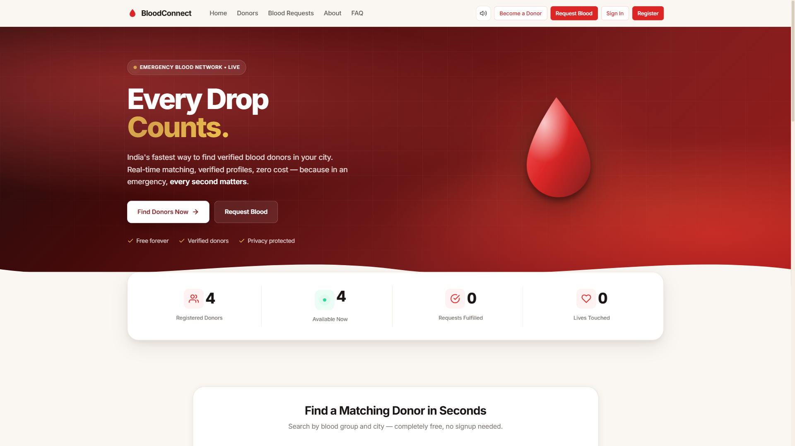
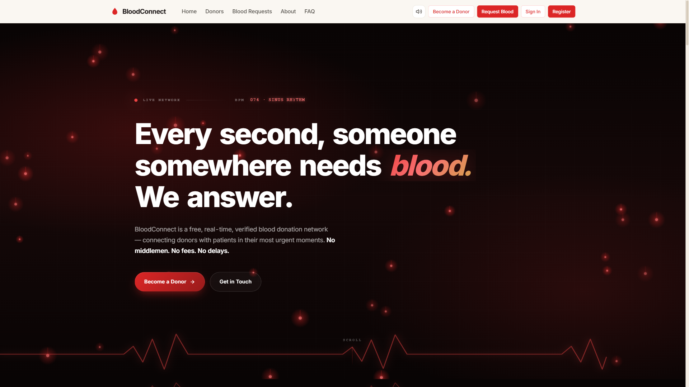
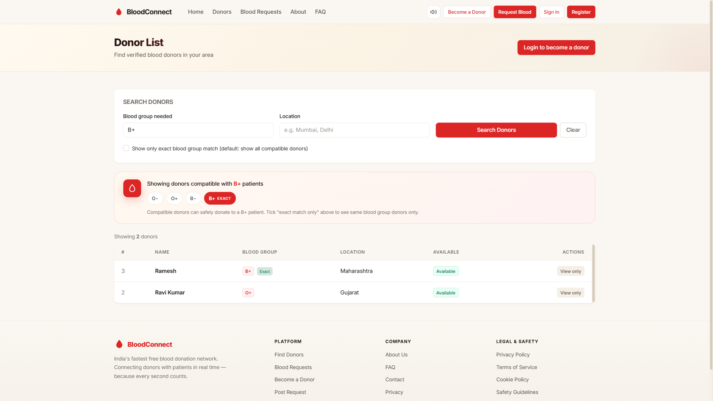
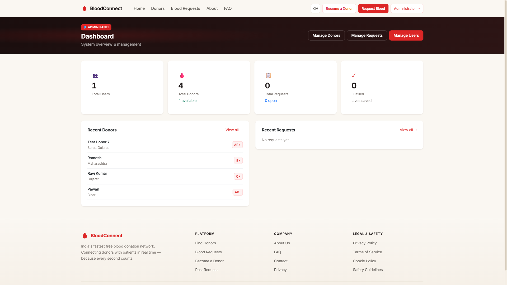
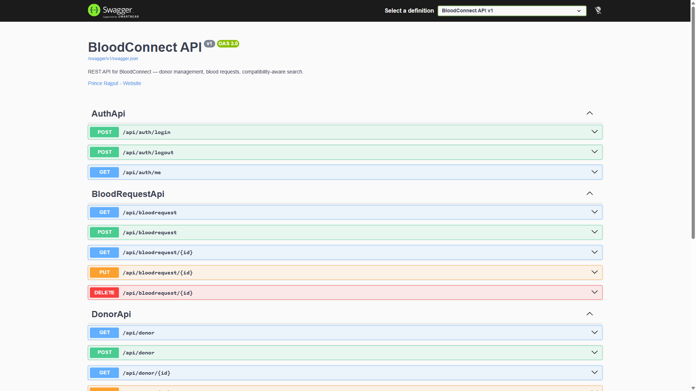

<div align="center">

# 🩸 BloodConnect

### Real-Time Blood Donation Network

**A production-grade full-stack platform connecting blood donors with patients in urgent need**

[](https://dotnet.microsoft.com/)
[](https://learn.microsoft.com/aspnet/core)
[](https://learn.microsoft.com/ef/core)
[](https://www.microsoft.com/sql-server)
[](https://dotnet.microsoft.com/apps/aspnet/signalr)
[](LICENSE)

[](https://bloodconnector.runasp.net)
[](https://bloodconnector.runasp.net/swagger)
[](https://github.com/rajputpri/BloodConnector)

**[🌐 Live Demo](https://bloodconnector.runasp.net)** · **[📖 API Docs](https://bloodconnector.runasp.net/swagger)** · **[🐛 Report Bug](https://github.com/rajputpri/BloodConnector/issues)** · **[✨ Request Feature](https://github.com/rajputpri/BloodConnector/issues)**

</div>

---

## 📸 Screenshots

<table>
  <tr>
    <td width="50%">
      <h4>🏠 Homepage</h4>
      
    </td>
    <td width="50%">
      <h4>🔔 Real-Time Notifications</h4>
      
    </td>
  </tr>
  <tr>
    <td width="50%">
      <h4>🩸 Blood Compatibility Chart</h4>
      
    </td>
    <td width="50%">
      <h4>🔍 Compatibility-Aware Search</h4>
      
    </td>
  </tr>
  <tr>
    <td width="50%">
      <h4>📊 Admin Dashboard</h4>
      
    </td>
    <td width="50%">
      <h4>📖 Swagger API Docs</h4>
      
    </td>
  </tr>
</table>

---

## 📖 Table of Contents

- [Overview](#-overview)
- [Real-Time Notifications](#-real-time-notifications)
- [Key Features](#-key-features)
- [Tech Stack](#-tech-stack)
- [Architecture](#-architecture)
- [Quick Start](#-quick-start)
- [Configuration](#-configuration)
- [API Documentation](#-api-documentation)
- [Donation Workflow](#-donation-workflow)
- [Blood Compatibility Logic](#-blood-compatibility-logic)
- [Authorization Model](#-authorization-model)
- [Real-Time Architecture](#-real-time-architecture)
- [Project Structure](#-project-structure)
- [Testing & Verification](#-testing--verification)
- [Deployment](#-deployment)
- [Documentation](#-documentation)
- [Roadmap](#-roadmap)
- [Contributing](#-contributing)
- [License](#-license)

---

## 🎯 Overview

**BloodConnect** is a **real-time blood donation management platform** that connects verified donors with patients during emergencies. It eliminates the friction of traditional methods (WhatsApp groups, phone calls, social media) by providing a **compatibility-aware, pledge-based matching system** with **live push notifications**.

### 💡 The Problem

- India requires **14.6 million blood units annually** but faces a **1.5 million unit shortage**
- Traditional donor discovery is **slow, unverified, and unreliable**
- No way to verify if a donor will actually show up
- Wrong blood group matching leads to **wasted critical time**
- Emergency coordination is fragmented across multiple channels with **zero visibility**

### ✅ Our Solution

| Feature | Impact |
|---------|--------|
| **Real-time matching** | Find compatible donors in seconds, not hours |
| **Two-way pledge system** | Both parties confirm — no fake fulfillments |
| **Medical accuracy** | Built-in blood compatibility matrix (O− universal donor, AB+ universal receiver) |
| **Privacy-first** | Contact details revealed only after mutual agreement |
| **Live notifications** | SignalR-powered real-time alerts with sound |
| **Zero cost** | Free forever — no premium tiers, no ads, no data selling |

---

## 🔔 Real-Time Notifications

**The killer feature that makes BloodConnect feel alive.**

### What Happens

| Trigger | Who Gets Notified | How |
|---------|------------------|-----|
| New blood request posted | **All Admins** | Bell badge + Toast + Sound |
| New contact message | **All Admins** | Bell badge + Toast + Sound |
| Donor pledges on a request | **Request Owner** | Bell badge + Toast + Sound |
| Owner accepts an offer | **Donor** | Bell badge + Toast + Sound |
| Owner rejects an offer | **Donor** | Bell badge + Toast + Sound |
| Donation completed | **Donor** | Bell badge + Toast + Sound |

### How It Works

- **SignalR WebSocket** — Persistent connection between browser and server
- **Role-based groups** — `admins` group for admin alerts, `user_{id}` group for personal alerts
- **WhatsApp-style chime** — Web Audio API with two-tone harmonic sound (880Hz + 1174Hz)
- **Animated bell** — Ring animation on new notification + bouncing badge
- **Toast popup** — Slide-in from top-right, auto-dismiss after 7 seconds, clickable
- **IMemoryCache fallback** — 60-second cached counts for initial page load
- **Explicit invalidation** — Cache cleared on every write operation

### Technical Highlights

- **Zero DB queries for non-admins** — Only admins hit the message count query (cached)
- **Automatic reconnection** — SignalR reconnects with exponential backoff
- **Sound persistence** — User toggle stored in `localStorage`
- **Reduced-motion support** — Respects `prefers-reduced-motion` for accessibility

---

## ✨ Key Features

### 👤 For Users
- **Register & authenticate** with ASP.NET Core Identity (secure password hashing, lockout protection)
- **Post blood requests** with urgency level, location, and contact details
- **Search compatible donors** by blood group, state, and availability
- **Track request status** in real-time (Open → Pledged → Accepted → Fulfilled)
- **Manage profile** through a personal dashboard
- **Receive live notifications** when donors pledge on your requests

### 🩸 For Donors
- **Create verified donor profile** with age validation (18-65 years)
- **Pledge to donate** on active requests using a two-way confirmation flow
- **Browse compatible requests** based on medical accuracy
- **Track personal donations** and contribution history
- **Control availability** status anytime
- **Get instant alerts** when your offer is accepted

### 🛡️ For Admins
- **Full user management** — ban/unban, promote/demote, delete
- **Role hierarchy** — SuperAdmin > Admin > User with strict enforcement
- **Moderate donors** — remove fraudulent entries
- **Manage blood requests** — delete policy violations
- **Contact message inbox** — read/unread tracking with cached badge count
- **Real-time dashboard** — stats on donors, requests, and fulfilled donations
- **Live notification feed** — instant alerts for new requests and messages

### ⚙️ Engineering Highlights
- **Real-time SignalR notifications** — WebSocket push with zero polling
- **REST API with Swagger UI** — 18+ documented endpoints
- **DTO pattern** for API responses (contact privacy protection)
- **RowVersion concurrency** on donor records
- **Global CSRF protection** via `AutoValidateAntiforgeryToken`
- **Cookie-based auth** with ban-checking middleware
- **Hybrid caching strategy** — `IMemoryCache` + SignalR + explicit invalidation
- **WhatsApp-style sound system** — Web Audio API with compressor + harmonic layering
- **EF Core migrations** for version-controlled schema
- **Compatibility matrix** centralized in `BloodCompatibility` helper
- **Unique compound index** prevents duplicate pledges
- **Web Audio API** — Real-time notification chimes
- **Responsive design** — Works on desktop, tablet, mobile

---

## 🛠 Tech Stack

<table>
<tr>
<td align="center" width="16%">

**Backend**
<br/>


</td>
<td align="center" width="16%">

**Framework**
<br/>


</td>
<td align="center" width="16%">

**Real-Time**
<br/>


</td>
<td align="center" width="16%">

**Database**
<br/>


</td>
<td align="center" width="16%">

**ORM**
<br/>


</td>
<td align="center" width="16%">

**API Docs**
<br/>


</td>
</tr>
</table>

| Layer | Technology | Version | Purpose |
|-------|-----------|---------|---------|
| Runtime | .NET | 10.0 | Application runtime |
| Web Framework | ASP.NET Core MVC | 10.0 | HTTP request handling |
| Real-Time | ASP.NET Core SignalR | 10.0 | WebSocket notifications |
| Data Access | Entity Framework Core | 10.0 | ORM with code-first migrations |
| Database | SQL Server Express | 2019+ | Persistent storage |
| Authentication | ASP.NET Core Identity | 10.0 | Cookie-based auth |
| API Documentation | Swashbuckle.AspNetCore | 10.2.3 | Swagger UI + OpenAPI 3.0 |
| Frontend | Razor Views + Bootstrap | 5.x | Server-rendered UI |
| Styling | Custom CSS (Inter font) | — | Warm premium design system |
| Icons | Inline SVG (Lucide-style) | — | Crisp vector icons |
| Caching | IMemoryCache | — | 60-second badge cache |
| Sound | Web Audio API | — | Two-tone notification chime |
| Real-Time Client | @microsoft/signalr | 8.0.7 | Browser WebSocket client |

---

## 🏗 Architecture

### High-Level Flow

```text
┌─────────────────────────────────────────────────────────────┐
│                         BROWSER                             │
│  (Desktop · Tablet · Mobile — Responsive via Bootstrap 5)   │
│  ┌────────────────┐  ┌────────────────┐  ┌───────────────┐  │
│  │  Razor Views   │  │  notifications │  │  SignalR      │  │
│  │  + Vanilla JS  │  │  .js (client)  │  │  WebSocket    │  │
│  └────────────────┘  └────────────────┘  └───────┬───────┘  │
└────────────────────┬─────────────────────────────┼──────────┘
                     │                             │
                     │ HTTP / HTTPS                │ WebSocket
                     ▼                             ▼
┌─────────────────────────────────────────────────────────────┐
│                    ASP.NET CORE MVC                         │
│  ┌─────────────┐  ┌─────────────┐  ┌─────────────────────┐  │
│  │ Controllers │  │  Services   │  │  SignalR Hub        │  │
│  │ (Business   │  │ (Message    │  │  (NotificationHub)  │  │
│  │  Logic)     │  │  Cache +    │  │                     │  │
│  │             │  │  Notif.)    │  │  Groups:            │  │
│  │             │  │             │  │  • admins           │  │
│  │             │  │             │  │  • user_{id}        │  │
│  └──────┬──────┘  └─────────────┘  └─────────────────────┘  │
│         │                                                    │
│  ┌──────▼──────┐  ┌─────────────┐  ┌─────────────────────┐  │
│  │   Models    │  │  ViewModels │  │  Razor Views        │  │
│  │ (Entities)  │  │  (DTOs)     │  │  (UI Layer)         │  │
│  └──────┬──────┘  └─────────────┘  └─────────────────────┘  │
└─────────┼───────────────────────────────────────────────────┘
          │
          │ EF Core (Code-First Migrations)
          ▼
┌─────────────────────────────────────────────────────────────┐
│                     SQL SERVER                              │
│  ┌──────────┐  ┌────────────┐  ┌──────────────────────┐    │
│  │ Identity │  │  Domain    │  │  Relationship        │    │
│  │  Tables  │  │  Tables    │  │  Tables              │    │
│  │  (5)     │  │  (4)       │  │  (Indexed, FK-linked)│    │
│  └──────────┘  └────────────┘  └──────────────────────┘    │
└─────────────────────────────────────────────────────────────┘
```

### Data Model

```text
AppUser ────┐
            │ owns
            ▼
          Donor ────┬──── DonationOffer ──── BloodRequest
                    │           │                 │
                    │           │                 │
                    └───────────┘                 │
                    (unique RequestId+DonorId)    │
                                                  │
                                                  │ owned by
                                                  ▼
                                                AppUser
```

### Design Principles

- **Separation of Concerns** — Controllers orchestrate, Models hold state, Views render
- **Thin Controllers** — Business logic pushed to domain services where it makes sense
- **No DB in Views** — All data prepared by controller actions
- **DTO Pattern for API** — Never expose entities directly; use `DonorDto`, `BloodRequestDto`
- **Server-Side Validation** — `[Required]`, `[Range]`, `[RegularExpression]`, custom `[MustBeTrue]`
- **Global CSRF** — Every form post validated via `AutoValidateAntiforgeryToken`
- **Role-Based Access** — `[Authorize(Roles = "...")]` + controller-level ownership checks
- **Real-Time First** — SignalR hub for push notifications, no polling
- **Cache Wisely** — `IMemoryCache` for read-heavy paths, invalidate on every write

---

## 🚀 Quick Start

### Prerequisites

- [.NET 10 SDK](https://dotnet.microsoft.com/download)
- [SQL Server Express](https://www.microsoft.com/sql-server/sql-server-downloads) or LocalDB
- [Git](https://git-scm.com/)
- Optional: [VS Code](https://code.visualstudio.com/) with C# Dev Kit

### Installation

```bash
# 1. Clone the repository
git clone https://github.com/rajputpri/BloodConnector.git
cd BloodConnector

# 2. Restore NuGet packages
dotnet restore

# 3. Install EF Core CLI (if not already)
dotnet tool install --global dotnet-ef

# 4. Update connection string in appsettings.Development.json
#    Example: "Server=localhost\\SQLEXPRESS04;Database=BloodConnectDb;Trusted_Connection=True;TrustServerCertificate=True;"

# 5. Apply migrations
dotnet ef database update

# 6. Run the application
dotnet run
```

**Application will be available at:** `http://localhost:5006`

### Default Admin Credentials

```text
Email:    admin@bloodconnect.com
Password: Admin@123
```

> [!WARNING]
> **Change these credentials immediately in production.** These are seeded for development only.

---

## ⚙ Configuration

### Development (`appsettings.Development.json`)

```json
{
  "ConnectionStrings": {
    "DefaultConnection": "Server=localhost\\SQLEXPRESS04;Database=BloodConnectDb;Trusted_Connection=True;TrustServerCertificate=True;MultipleActiveResultSets=true"
  }
}
```

### Production (`appsettings.Production.json`)

```json
{
  "ConnectionStrings": {
    "DefaultConnection": "Server=YOUR_SERVER;Database=YOUR_DB;User Id=YOUR_USER;Password=YOUR_PASSWORD;Encrypt=False;TrustServerCertificate=True;MultipleActiveResultSets=True"
  }
}
```

> [!IMPORTANT]
> `appsettings.Production.json` is **excluded from version control** (see `.gitignore`). Upload it manually to the hosting server or set via environment variables.

### Environment Variables (Alternative)

| Variable | Purpose |
|----------|---------|
| `ASPNETCORE_ENVIRONMENT` | Set to `Production` on hosting server |
| `ConnectionStrings__DefaultConnection` | Production DB connection string |

---

## 📡 API Documentation

**Live Swagger UI:** [https://bloodconnector.runasp.net/swagger](https://bloodconnector.runasp.net/swagger)

### Endpoints Overview

#### 🔐 Auth APIs

| Method | Endpoint | Auth | Purpose |
|--------|----------|:----:|---------|
| `POST` | `/api/auth/login` | 🌐 Public | Login via JSON (returns cookie) |
| `POST` | `/api/auth/logout` | 🔒 Auth | Logout current session |
| `GET` | `/api/auth/me` | 🔒 Auth | Current user info + roles |

#### 🩸 Donor APIs

| Method | Endpoint | Auth | Purpose |
|--------|----------|:----:|---------|
| `GET` | `/api/donor` | 🌐 Public | List all donors (paginated) |
| `GET` | `/api/donor/{id}` | 🌐 Public | Get single donor by ID |
| `GET` | `/api/donor/search` | 🌐 Public | Compatibility-aware search |
| `POST` | `/api/donor` | 🔒 Auth | Create new donor profile |
| `PUT` | `/api/donor/{id}` | 🔒 Owner/Admin | Update donor |
| `DELETE` | `/api/donor/{id}` | 🔒 Owner/Admin | Delete donor |

#### 📋 Blood Request APIs

| Method | Endpoint | Auth | Purpose |
|--------|----------|:----:|---------|
| `GET` | `/api/bloodrequest` | 🌐 Public | List all blood requests |
| `GET` | `/api/bloodrequest/{id}` | 🌐 Public | Get single request |
| `POST` | `/api/bloodrequest` | 🔒 Auth | Create new request |
| `PUT` | `/api/bloodrequest/{id}` | 🔒 Owner/Admin | Update request |
| `DELETE` | `/api/bloodrequest/{id}` | 🔒 Owner/Admin | Delete request |

**Full API reference:** [docs/API.md](docs/API.md)

### Sample Response — `GET /api/donor/search?bloodGroup=B%2B`

```json
{
  "total": 2,
  "page": 1,
  "pageSize": 20,
  "searchMode": "compatible",
  "requestedBloodGroup": "B+",
  "compatibleGroups": ["O-", "O+", "B-", "B+"],
  "results": [
    {
      "donorId": 15,
      "name": "Gaurav",
      "bloodGroup": "B+",
      "state": "Bihar",
      "location": "Bihar",
      "isExactMatch": true
    }
  ]
}
```

### Sample Request — `POST /api/auth/login`

```json
{
  "email": "admin@bloodconnect.com",
  "password": "Admin@123"
}
```

**Response:** `200 OK` + `Set-Cookie: .AspNetCore.Identity.Application=...`

---

## 🤝 Donation Workflow

### Pledge-Based Two-Way Confirmation

```text
┌──────────┐    ┌──────────┐    ┌──────────┐    ┌──────────┐
│ PLEDGED  │───▶│ ACCEPTED │───▶│COMPLETED │───▶│FULFILLED │
└──────────┘    └──────────┘    └──────────┘    └──────────┘
     │
     ├──▶ CANCELLED  (donor cancels before acceptance)
     └──▶ REJECTED   (owner chooses another donor)
```

### Rules

- ✅ A donor can pledge **once per request** — enforced by unique `(RequestId, DonorId)` index
- ✅ **Cannot pledge on own request**
- ✅ **Blood group must match** — validated server-side
- ✅ Accepting one offer **auto-rejects all other pending offers**
- ✅ **Contact details revealed only after acceptance**
- ✅ Both owner **and** accepted donor can mark donation complete
- ✅ Fulfilled requests **cannot accept new offers**
- ✅ **Every state change triggers a real-time SignalR notification**

---

## 🩸 Blood Compatibility Logic

### Red Cell Compatibility Matrix

| Recipient | Can Receive From |
|-----------|-----------------|
| **O−**  | O− |
| **O+**  | O−, O+ |
| **A−**  | O−, A− |
| **A+**  | O−, O+, A−, A+ |
| **B−**  | O−, B− |
| **B+**  | O−, O+, B−, B+ |
| **AB−** | O−, A−, B−, AB− |
| **AB+** | All 8 groups |

### Key Facts

- **🩸 O− is the universal donor** — can donate red cells to all 8 groups
- **🩸 AB+ is the universal receiver** — can receive red cells from all 8 groups
- **A+ and B+** are the most common in India (~30% and ~24%)

This logic is centralized in `BloodCompatibility.cs` and applied consistently across:
- Web-based donor search
- API search endpoint
- Donation offer validation

---

## 🔐 Authorization Model

### Role Hierarchy

```text
┌─────────────────────────────────────────┐
│           SuperAdmin                     │  ← Highest
│         (Immutable, undeletable)        │
└────────────────┬────────────────────────┘
                 │
                 ▼
┌─────────────────────────────────────────┐
│              Admin                       │
│   (Can manage users below, moderate)     │
└────────────────┬────────────────────────┘
                 │
                 ▼
┌─────────────────────────────────────────┐
│              User                        │  ← Lowest
│         (Basic access)                   │
└─────────────────────────────────────────┘
```

### Permission Matrix

| Action | User | Admin | SuperAdmin |
|--------|:----:|:-----:|:----------:|
| Edit own donor profile | ✅ | ✅ | ✅ |
| Edit another's profile | ❌ | ❌ | ❌ |
| Delete own request | ✅ | ✅ | ✅ |
| Delete another's request | ❌ | ✅ | ✅ |
| Ban regular user | ❌ | ✅ | ✅ |
| Ban an Admin | ❌ | ❌ | ✅ |
| Ban a SuperAdmin | ❌ | ❌ | ❌ |
| Promote User → Admin | ❌ | ✅ | ✅ |
| Demote Admin → User | ❌ | ❌ | ✅ |
| Delete SuperAdmin | ❌ | ❌ | ❌ |
| Ban/delete self | ❌ | ❌ | ❌ |

---

## 🔄 Real-Time Architecture

### SignalR Flow

```text
┌────────────────────────────────────────────────────────────┐
│                       SIGNALR HUB                          │
│                   (/hubs/notifications)                    │
│                                                            │
│  Connection Groups:                                        │
│  • "admins"          ← All Admin + SuperAdmin users        │
│  • "user_{userId}"   ← Individual user (personal alerts)   │
└──────────────────────┬─────────────────────────────────────┘
                       │
                       │  OnWrite (Push)
                       │
    ┌──────────────────┼──────────────────┐
    │                  │                  │
    ▼                  ▼                  ▼
┌─────────┐      ┌──────────┐      ┌──────────────┐
│ New     │      │ New      │      │ Offer Status │
│ Request │      │ Offer    │      │ Changed      │
└────┬────┘      └────┬─────┘      └──────┬───────┘
     │                │                    │
     ▼                ▼                    ▼
  admins          user_{id}            user_{id}
  group           (request owner)      (donor)
```

### Notification Payload

```json
{
  "type": "request",
  "title": "New A+ request",
  "message": "Rahul Sharma · Mumbai, Maharashtra",
  "url": "/BloodRequest/Index",
  "timestamp": "2026-10-12T14:23:45.123Z"
}
```

### Client-Side Handling

1. **SignalR receives** → `ReceiveNotification` event
2. **Bell badge** → Increment with bounce animation
3. **Bell icon** → Ring animation for 0.6s
4. **Dropdown** → Prepend new item with highlight fade
5. **Sound** → Play two-tone chime (880Hz → 1174Hz)
6. **Toast** → Slide in from top-right, auto-dismiss after 7s
7. **Click** → Navigate to `payload.url`

### Server-Side Push

Every write operation triggers a push:

```csharp
// In BloodRequestController.Create
_context.BloodRequests.Add(request);
await _context.SaveChangesAsync();
await _notifications.PushNewRequestToAdminsAsync(request);

// In BloodRequestController.Offer
await _notifications.PushNewOfferToOwnerAsync(request, newOffer);

// In BloodRequestController.AcceptOffer
await _notifications.PushOfferStatusToDonorAsync(
    offer.Donor.UserId, DomainValues.Accepted, offer.RequestId);
```

---

## 📁 Project Structure

```text
BloodConnect/
├── 📁 Controllers/                      # HTTP request handlers
│   ├── HomeController.cs                # Homepage, About, Contact, Error
│   ├── DonorController.cs               # Donor CRUD + compatibility search
│   ├── BloodRequestController.cs        # Request CRUD + offer workflow
│   ├── DonorApiController.cs            # REST API for donors
│   ├── BloodRequestApiController.cs     # REST API for requests
│   ├── AuthApiController.cs             # 🆕 Auth API (login/logout/me)
│   ├── AccountController.cs             # Register, Login, Logout (MVC)
│   ├── AdminController.cs               # Admin panel + role management
│   └── DashboardController.cs           # User dashboard
│
├── 📁 Hubs/                             # 🆕 SignalR Hubs
│   └── NotificationHub.cs               # Real-time WebSocket hub
│
├── 📁 Models/                           # Domain entities + ViewModels
│   ├── AppUser.cs                       # Extended IdentityUser
│   ├── Donor.cs                         # Donor entity
│   ├── BloodRequest.cs                  # Blood request entity
│   ├── DonationOffer.cs                 # Pledge workflow entity
│   ├── ContactMessage.cs                # Contact form submissions
│   ├── BloodCompatibility.cs            # Compatibility logic
│   ├── DomainValues.cs                  # Constants (blood groups, states, etc.)
│   ├── ValidationAttributes.cs          # Custom validators
│   ├── ApplicationDbContext.cs          # EF Core DbContext
│   ├── DbSeeder.cs                      # Seed data (roles, admin)
│   ├── ApiDtos.cs                       # API data transfer objects
│   └── ViewModels.cs                    # View-specific models
│
├── 📁 Services/                         # Cross-cutting concerns
│   ├── MessageCache.cs                  # Cached unread message count
│   └── NotificationService.cs           # 🆕 SignalR + cache notifications
│
├── 📁 Migrations/                       # EF Core migrations
│
├── 📁 Views/                            # Razor UI templates
│   ├── Shared/                          # Layouts, partials
│   ├── Home/                            # Homepage, About, Contact, FAQ
│   ├── Donor/                           # Donor pages
│   ├── BloodRequest/                    # Request pages
│   ├── Account/                         # Auth pages
│   ├── Admin/                           # Admin panel
│   └── Dashboard/                       # User dashboard
│
├── 📁 wwwroot/                          # Static assets
│   ├── css/
│   │   ├── site.css                     # Main design system
│   │   ├── animations.css               # Toast, loader, splash
│   │   └── notifications.css            # 🆕 Notification toasts
│   ├── js/
│   │   ├── site.js                      # Navbar, alerts, counters
│   │   ├── animations.js                # Toast, modal, sound system
│   │   └── notifications.js             # 🆕 SignalR client + bell + sound
│   └── lib/                             # Bootstrap, jQuery
│
├── 📁 docs/                             # 📚 Documentation
│   ├── API.md
│   ├── ARCHITECTURE.md
│   ├── DEPLOYMENT.md
│   ├── SECURITY.md
│   ├── USER_MANUAL.md
│   ├── CHANGELOG.md
│   ├── postman/                         # Postman collection
│   └── screenshots/                     # Organized screenshot gallery
│
├── 📄 Program.cs                        # Application entry point
├── 📄 appsettings.json
├── 📄 appsettings.Development.json
├── 📄 appsettings.Production.json       (gitignored)
├── 📄 BloodConnect.csproj
└── 📄 README.md
```

---

## ✅ Testing & Verification

### Manual Verification Checklist

| Area | Scenarios |
|------|-----------|
| **Authentication** | Registration, login, logout, lockout (5 attempts), weak password rejection |
| **Authorization** | Owner-only edit, admin delete, role hierarchy, self-protection |
| **Ban System** | Banned user auto-signed out, login denied |
| **Donor CRUD** | Create, edit, delete, age validation (18-65) |
| **Search** | Compatible + exact match, ordering, state filter |
| **Workflow** | Offer, accept, reject competing offers, cancel, complete |
| **Compatibility** | All 8 groups, universal donor/receiver cases |
| **Contact Inbox** | Persistence, read/unread, deletion, cache invalidation |
| **Real-Time Notifications** | Bell badge, toast, sound, dropdown live updates |
| **Error Handling** | Branded 404/500 without stack traces |

### API Testing

All API endpoints tested via **Swagger UI** and **Postman**.

📸 **Screenshots:** [docs/screenshots/api-deployment/](docs/screenshots/api-deployment/)

### Real-Time Testing

Test with 2 browsers:
1. **Browser A:** Login as admin
2. **Browser B:** Login as normal user → post a blood request
3. **Browser A:** Should receive toast + sound + bell badge **instantly** ⚡

---

## 🚀 Deployment

**Live Production:** [https://bloodconnector.runasp.net](https://bloodconnector.runasp.net)

### Deployed On

| Component | Service |
|-----------|---------|
| **Hosting** | MonsterASP.NET (Free tier) |
| **Database** | SQL Server 2025 (MonsterASP managed) |
| **HTTPS** | Let's Encrypt SSL |
| **Auto-deploy** | GitHub → Build & Publish |
| **Real-Time** | SignalR over WebSocket |

**Full deployment guide:** [docs/DEPLOYMENT.md](docs/DEPLOYMENT.md)

---

## 📚 Documentation

| Document | Purpose |
|----------|---------|
| [README.md](README.md) | Project overview (this file) |
| [docs/API.md](docs/API.md) | Complete API reference |
| [docs/ARCHITECTURE.md](docs/ARCHITECTURE.md) | System design & data model |
| [docs/DEPLOYMENT.md](docs/DEPLOYMENT.md) | Step-by-step deployment |
| [docs/SECURITY.md](docs/SECURITY.md) | Security model & threat analysis |
| [docs/USER_MANUAL.md](docs/USER_MANUAL.md) | User guide |
| [docs/CHANGELOG.md](docs/CHANGELOG.md) | Version history |

---

## 🗺 Roadmap

### ✅ Completed (Phase 1-4.5)

**Phase 1 — Foundation**
- [x] ASP.NET Core MVC project scaffold
- [x] ASP.NET Core Identity authentication
- [x] Role-based authorization
- [x] Bootstrap 5 UI + custom design system
- [x] Homepage with hero section
- [x] About, FAQ, Contact pages

**Phase 2 — Forms & Validation**
- [x] Donor CRUD with validation
- [x] Blood request management
- [x] Compatibility-aware search
- [x] Custom `MustBeTrue` validation
- [x] Age validation (18-65)

**Phase 3 — Database & CRUD**
- [x] Contact message feature (admin inbox)
- [x] Cached unread badge counter
- [x] SuperAdmin protection rules
- [x] Role management UI
- [x] Pledge-based donation workflow

**Phase 4 — API, Deployment & Real-Time**
- [x] State dropdown (28 states + 8 UTs)
- [x] REST API with full CRUD
- [x] Swagger UI documentation
- [x] Auth API endpoints (`/api/auth/*`)
- [x] Live deployment on MonsterASP.NET
- [x] HTTPS with Let's Encrypt
- [x] **SignalR real-time notifications** 🆕
- [x] **Bell icon with live badge** 🆕
- [x] **WhatsApp-style sound chime** 🆕
- [x] **Toast notifications** 🆕
- [x] **Hybrid cache + push architecture** 🆕

### 🚀 Planned

- [ ] Email notifications (SendGrid)
- [ ] SMS alerts (Twilio)
- [ ] Mobile app (React Native)
- [ ] Hospital integration API
- [ ] Analytics dashboard (Chart.js)
- [ ] Multi-language support (Hindi, Gujarati)
- [ ] Map-based donor view (Google Maps)
- [ ] Two-factor authentication
- [ ] Donation eligibility check (weight, last donation)
- [ ] Referral program

---

## 🤝 Contributing

This is an **educational project**. Contributions are welcome for:

- 🐛 Bug fixes
- 📝 Documentation improvements
- ✨ Feature suggestions
- 🎨 UI/UX enhancements

**Process:**
1. Fork the repository
2. Create a feature branch (`git checkout -b feature/amazing-feature`)
3. Commit your changes (`git commit -m 'Add amazing feature'`)
4. Push to the branch (`git push origin feature/amazing-feature`)
5. Open a Pull Request

---

## 📜 License

This project is provided for **educational use**. See [LICENSE](LICENSE) for details.

---

## 👨‍💻 Author

**Prince Rajput**
BCA Semester 7 · DSC-M-CBA 471P · Gujarat University

[](https://github.com/rajputpri)

---

## ⚠️ Disclaimer

BloodConnect is an **educational project** demonstrating full-stack ASP.NET Core development. It is **not a medical, emergency-response, or production blood-bank system**. The compatibility lookup is a simplified educational reference and does not replace professional blood typing, crossmatching, screening, or clinical judgment.

Do **not** rely on this application for real medical decisions.

---

<div align="center">

**Made with ❤️ in India**

**Every drop counts.** 🩸

⭐ **Star this repo if it helped you!** ⭐

</div>