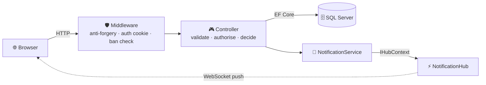
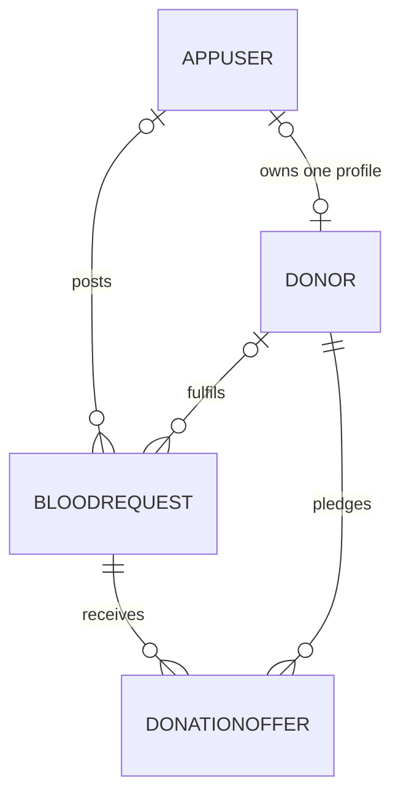
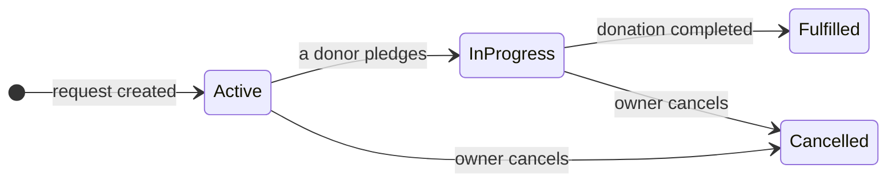
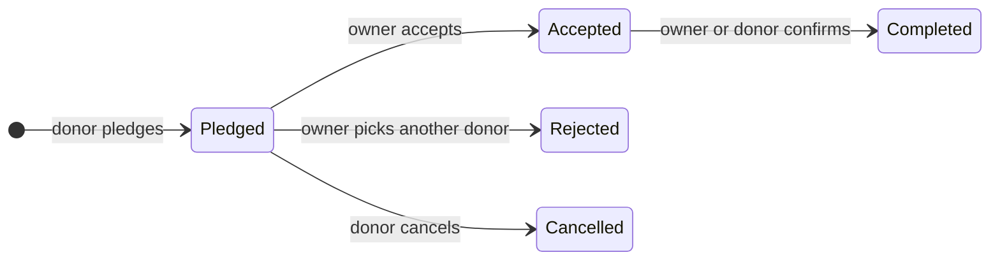
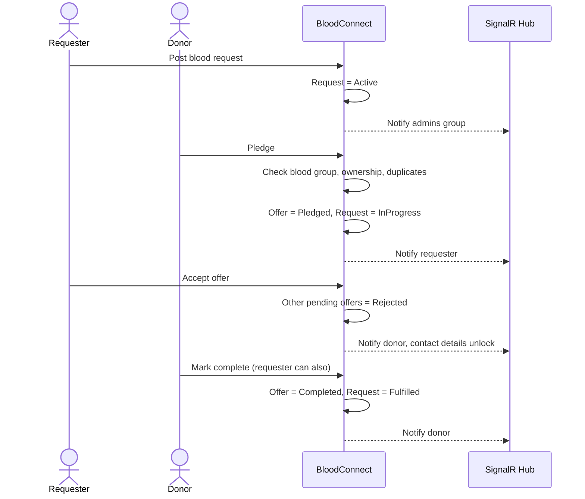

<div align="center">



### 🩸 Real-Time Blood Donation Network

**A full-stack platform that connects verified blood donors with patients in urgent need, using compatibility-aware search, a two-way pledge workflow and live push notifications.**

[](https://dotnet.microsoft.com/)
[](https://learn.microsoft.com/aspnet/core)
[](https://learn.microsoft.com/ef/core)
[](https://www.microsoft.com/sql-server)
[](https://dotnet.microsoft.com/apps/aspnet/signalr)
[](https://bloodconnector.runasp.net/swagger)

[](https://bloodconnector.runasp.net)
[](https://bloodconnector.runasp.net/swagger)
[](https://github.com/rajputpri/BloodConnector)

**[🌐 Live Demo](https://bloodconnector.runasp.net)** · **[📖 API Docs](https://bloodconnector.runasp.net/swagger)** · **[🚀 Quick Start](#-quick-start)** · **[🐛 Report a Bug](https://github.com/rajputpri/BloodConnector/issues)** · **[✨ Request a Feature](https://github.com/rajputpri/BloodConnector/issues)**

</div>

<p align="center"></p>

## 📊 Project at a Glance

<div align="center">


</div>

| | |
|---|---|
| **Project** | BloodConnect, "Every Drop Counts" |
| **Domain** | Healthcare, emergency blood donation management |
| **Type** | Final-year BCA (Honours) project, Semester 7 |
| **Course** | Full Stack Web Development Project using ASP.NET Core (DSC-M-BCA-471P) |
| **University** | Gujarat University (NEP 2020), Lokmanya College of Computer Applications |
| **Author** | Prince Rajput |
| **Status** | Deployed and running on MonsterASP.NET |

---

## 📖 Table of Contents

- [🎯 The Problem and the Solution](#-the-problem-and-the-solution)
- [📸 Screenshots](#-screenshots)
- [🧭 Try It in 60 Seconds](#-try-it-in-60-seconds)
- [✨ Key Features](#-key-features)
- [🔔 Real-Time Notifications](#-real-time-notifications)
- [🛠 Tech Stack](#-tech-stack)
- [🏗 Architecture](#-architecture)
- [🧬 Domain Model](#-domain-model)
- [🤝 Donation Workflow](#-donation-workflow)
- [🩸 Blood Compatibility Logic](#-blood-compatibility-logic)
- [🛡 Security and Identity](#-security-and-identity)
- [🔐 Authorization Model](#-authorization-model)
- [📡 API Documentation](#-api-documentation)
- [🚀 Quick Start](#-quick-start)
- [⚙ Configuration](#-configuration)
- [📁 Project Structure](#-project-structure)
- [✅ Testing and Verification](#-testing-and-verification)
- [🚀 Deployment](#-deployment)
- [🧠 Design Decisions](#-design-decisions)
- [⚠ Known Limitations](#-known-limitations)
- [🗺 Roadmap](#-roadmap)
- [📚 Documentation](#-documentation)
- [🤝 Contributing](#-contributing) · [📜 License](#-license) · [👨‍💻 Author](#-author)

<p align="center"></p>

## 🎯 The Problem and the Solution

### 😟 The problem

In an emergency, finding blood is a race against time, and the tools people use today are not built for it.

- 📱 **Scattered coordination.** Requests travel through WhatsApp groups, phone calls and social media. There is no single place to see who needs what.
- ❓ **No verification.** Nobody knows if a donor is genuine, currently available, or will actually show up.
- 🧪 **Wrong-group matching wastes minutes.** People call donors who medically cannot donate to that patient.
- 📞 **Privacy leaks.** Phone numbers are posted publicly and end up in spam lists.
- 🙈 **Zero visibility.** The requester cannot tell whether anyone has responded.

> [!NOTE]
> **The scale of the gap.** India's estimated clinical demand is about **14.6 million units of blood a year**, with a supply gap of roughly **1 million units** (about 33.8 donations supplied against 36.3 needed per 1,000 eligible people).
> Source: *The clinical demand and supply of blood in India: A national level estimation study*, PLOS ONE, 2022 ([doi:10.1371/journal.pone.0265951](https://doi.org/10.1371/journal.pone.0265951)).

### ✅ The solution

| ❌ Problem | ✅ BloodConnect answer | 🔒 Design guarantee |
|---|---|---|
| Scattered coordination | One network with a live request board | One source of truth |
| Unverified donors | Pledge → accept → complete (two-way confirmation) | No fulfilment without both sides |
| Wrong-group matches | Built-in red-cell compatibility matrix | Search returns only compatible donors |
| Privacy leaks | Contact details hidden until an offer is accepted | **0** phone numbers shown before consent |
| Duplicate or fake pledges | Unique `(RequestId, DonorId)` index plus server-side rules | **0** duplicate pledges, enforced by the database |
| No visibility | SignalR push to the right person at every state change | **0** polling requests |

> The guarantees above come from the design and database constraints. They are not load-test benchmarks, and no performance numbers are claimed.

---

## 📸 Screenshots

<table>
  <tr>
    <td width="50%"><h4>🏠 Homepage</h4></td>
    <td width="50%"><h4>🔔 Real-time notifications</h4></td>
  </tr>
  <tr>
    <td width="50%"><h4>🩸 Blood compatibility chart</h4></td>
    <td width="50%"><h4>🔍 Compatibility-aware search</h4></td>
  </tr>
  <tr>
    <td width="50%"><h4>📊 Admin dashboard</h4></td>
    <td width="50%"><h4>📖 Swagger API docs</h4></td>
  </tr>
</table>

---

## 🧭 Try It in 60 Seconds

Two browsers (or one normal window and one private window) show the whole system working.

```text
 BROWSER A (Admin)                       BROWSER B (Normal user)
 ─────────────────                       ───────────────────────
 1. Sign in as admin                     1. Register a new account
 2. Keep any page open  ───────────────▶ 2. Create a donor profile
                                         3. Post a blood request
 3. 🔔 Bell badge + toast + chime        
    appear INSTANTLY, no refresh  ◀───── (SignalR push to the "admins" group)

 BROWSER B (a second user pledges)       BROWSER B (request owner)
 ─────────────────────────────────       ─────────────────────────
 4. Donor pledges on the request ──────▶ 5. 🔔 Owner is notified live
                                         6. Owner accepts the offer
 7. 🔔 Donor notified, contact details ◀──── (other pending offers auto-rejected)
    unlock for both sides
 8. Either side marks "complete"  ─────▶ Request becomes Fulfilled
```

---

## ✨ Key Features

<table>
<tr>
<td width="33%" valign="top">

### 👤 Users
- Register and sign in with ASP.NET Core Identity
- Post blood requests with urgency, location and contact
- Search compatible donors by group, state and availability
- Track a request live: `Active → InProgress → Fulfilled`
- Personal dashboard
- Live alerts when donors pledge

</td>
<td width="33%" valign="top">

### 🩸 Donors
- Verified profile with age validation (18 to 65)
- Pledge through a two-way confirmation flow
- Browse only the requests your group can medically serve
- Control availability at any time
- Instant alerts when an offer is accepted
- Track personal donations

</td>
<td width="33%" valign="top">

### 🛡️ Admins
- Ban, unban, promote, demote and delete users
- Strict role hierarchy with an immutable SuperAdmin
- Moderate donors and blood requests
- Contact inbox with read/unread tracking
- Live dashboard statistics
- Real-time notification feed

</td>
</tr>
</table>

### ⚙️ Engineering highlights

| Area | What is implemented |
|---|---|
| **Real-time** | SignalR WebSocket push with zero polling |
| **API** | REST with Swagger / OpenAPI, DTOs so contact data never leaks |
| **Concurrency** | `RowVersion` optimistic concurrency on donor records |
| **CSRF** | Global `AutoValidateAntiforgeryToken` |
| **Auth** | Cookie authentication with ban-checking on every request |
| **Caching** | Hybrid: `IMemoryCache` plus SignalR plus explicit invalidation on writes |
| **Integrity** | Unique compound index prevents duplicate pledges |
| **Domain logic** | Compatibility matrix centralised in one `BloodCompatibility` helper |
| **Sound** | Web Audio API two-tone chime with a persisted mute toggle |
| **UX** | Responsive layout, branded 404/500 pages, reduced-motion support |
| **Data** | EF Core migrations, version-controlled schema |

---

## 🔔 Real-Time Notifications

> **The feature that makes BloodConnect feel alive.** Things happen on your screen the moment they happen on the server.

| Trigger | Who is notified | Delivery |
|---|---|---|
| New blood request posted | **All admins** | 🔔 Badge · 🍞 Toast · 🔊 Sound |
| New contact message | **All admins** | 🔔 Badge · 🍞 Toast · 🔊 Sound |
| Donor pledges on a request | **Request owner** | 🔔 Badge · 🍞 Toast · 🔊 Sound |
| Owner accepts an offer | **The donor** | 🔔 Badge · 🍞 Toast · 🔊 Sound |
| Owner rejects an offer | **The donor** | 🔔 Badge · 🍞 Toast · 🔊 Sound |
| Donation completed | **The donor** | 🔔 Badge · 🍞 Toast · 🔊 Sound |

### How it works

```text
  Page load ─▶ browser opens a WebSocket to /hubs/notifications
                              │
                              ▼
            Server adds the connection to groups
              • "admins"          (Admin and SuperAdmin)
              • "user_{userId}"   (every signed-in user)
                              │
   A user acts (HTTP) ─▶ Controller saves to SQL ─▶ NotificationService
                                                         │ IHubContext
                                                         ▼
                                       Hub pushes "ReceiveNotification"
                                       to the correct group only
                                                         │
                                                         ▼
  Browser: badge bounces → bell rings (0.6 s) → item prepends to dropdown
           → chime plays → toast slides in (7 s) → click opens target URL
```

### Client-side handling
1. SignalR receives the `ReceiveNotification` event.
2. The bell badge increments with a bounce animation.
3. The bell rings for 0.6 seconds.
4. The dropdown prepends the new item with a highlight fade.
5. A two-tone chime plays (880 Hz then 1174 Hz).
6. A toast slides in from the top-right and auto-dismisses after 7 seconds.
7. Clicking the toast navigates to `payload.url`.

### Payload

```json
{
  "type": "request",
  "title": "New A+ request",
  "message": "Rahul Sharma · Mumbai, Maharashtra",
  "url": "/BloodRequest/Index",
  "timestamp": "2026-10-12T14:23:45.123Z"
}
```

### Server-side push (save first, then notify)

```csharp
// BloodRequestController.Create
_context.BloodRequests.Add(request);
await _context.SaveChangesAsync();
await _notifications.PushNewRequestToAdminsAsync(request);

// BloodRequestController.Offer
await _notifications.PushNewOfferToOwnerAsync(request, newOffer);

// BloodRequestController.AcceptOffer
await _notifications.PushOfferStatusToDonorAsync(
    offer.Donor.UserId, DomainValues.Accepted, offer.RequestId);
```

### Technical highlights
- **Zero database queries for non-admins:** only admins hit the cached unread-message count.
- **Automatic reconnection** with exponential backoff.
- **Sound persistence:** the mute toggle is stored in `localStorage`.
- **Accessibility:** respects `prefers-reduced-motion`.
- **IMemoryCache fallback:** 60-second cached counts for the first page load, **cleared on every write**.

---

## 🛠 Tech Stack

<table>
<tr>
<td align="center" width="16%"><b>Backend</b><br/></td>
<td align="center" width="16%"><b>Framework</b><br/></td>
<td align="center" width="16%"><b>Real-Time</b><br/></td>
<td align="center" width="16%"><b>Database</b><br/></td>
<td align="center" width="16%"><b>ORM</b><br/></td>
<td align="center" width="16%"><b>API Docs</b><br/></td>
</tr>
</table>

| Layer | Technology | Version | Purpose |
|---|---|---|---|
| Runtime | .NET | 10.0 | Application runtime |
| Web framework | ASP.NET Core MVC | 10.0 | HTTP handling, Razor views, REST controllers |
| Real-time | ASP.NET Core SignalR | 10.0 | WebSocket notifications |
| Data access | Entity Framework Core (Code First) | 10.0 | ORM and migrations |
| Database | SQL Server Express / SQL Server | 2019+ | Persistent storage |
| Authentication | ASP.NET Core Identity (cookie) | 10.0 | Sessions, roles, lockout |
| API documentation | Swashbuckle.AspNetCore | 10.2.3 | Swagger UI and OpenAPI 3.0 |
| Frontend | Razor views + Bootstrap | 5.x | Server-rendered responsive UI |
| Styling | Custom CSS, Inter font | n/a | Warm premium theme: cream `#FDF6EC`, burgundy `#7B1E28`, gold `#D4A24C` |
| Icons | Inline SVG (Lucide-style) | n/a | Crisp vector icons |
| Caching | `IMemoryCache` | n/a | 60-second unread-count cache |
| Sound | Web Audio API | n/a | Notification chime |
| Real-time client | `@microsoft/signalr` | 8.0.7 | Browser WebSocket client |
| API testing | Postman (cookie-based) | n/a | 28 recorded tests |

---

## 🏗 Architecture

### High-level flow

```text
┌─────────────────────────────────────────────────────────────┐
│                         BROWSER                             │
│  (Desktop · Tablet · Mobile, responsive via Bootstrap 5)    │
│  ┌────────────────┐  ┌────────────────┐  ┌───────────────┐  │
│  │  Razor Views   │  │  notifications │  │  SignalR      │  │
│  │  + Vanilla JS  │  │  .js (client)  │  │  WebSocket    │  │
│  └────────────────┘  └────────────────┘  └───────┬───────┘  │
└────────────────────┬─────────────────────────────┼──────────┘
                     │ HTTP / HTTPS                │ WebSocket
                     ▼                             ▼
┌─────────────────────────────────────────────────────────────┐
│                    ASP.NET CORE MVC                         │
│   Middleware: HTTPS · Anti-forgery · Auth cookie · Ban check│
│  ┌─────────────┐  ┌─────────────┐  ┌─────────────────────┐  │
│  │ Controllers │  │  Services   │  │  SignalR Hub        │  │
│  │ (MVC + REST)│  │ MessageCache│  │  NotificationHub    │  │
│  │             │  │ Notification│  │  Groups:            │  │
│  │             │  │ Service     │  │  • admins           │  │
│  │             │  │             │  │  • user_{id}        │  │
│  └──────┬──────┘  └─────────────┘  └─────────────────────┘  │
│  ┌──────▼──────┐  ┌─────────────┐  ┌─────────────────────┐  │
│  │   Models    │  │  ViewModels │  │  Razor Views        │  │
│  │ (Entities)  │  │  + DTOs     │  │  (UI layer)         │  │
│  └──────┬──────┘  └─────────────┘  └─────────────────────┘  │
└─────────┼───────────────────────────────────────────────────┘
          │ EF Core (Code-First migrations)
          ▼
┌─────────────────────────────────────────────────────────────┐
│                       SQL SERVER                            │
│   Identity tables  ·  Domain tables  ·  Indexed, FK-linked  │
└─────────────────────────────────────────────────────────────┘
```

### Request pipeline



### Design principles
- **Separation of concerns:** controllers orchestrate, models hold state, views render.
- **Thin controllers:** notification and cache logic live in services.
- **No database access in views:** controllers prepare everything a view needs.
- **DTO pattern for the API:** entities are never exposed directly (`DonorDto`, `BloodRequestDto`).
- **Server-side validation always:** `[Required]`, `[Range]`, `[RegularExpression]` and a custom `[MustBeTrue]`.
- **Role plus ownership:** `[Authorize(Roles = "...")]` and controller-level ownership checks.
- **Real-time first:** SignalR push, no polling.
- **Cache wisely:** `IMemoryCache` for read-heavy paths, invalidated on every write.
- **Save first, then notify:** data is committed before any push goes out.

---

## 🧬 Domain Model

### Entities

| Entity | Responsibility | Key fields |
|---|---|---|
| **AppUser** (extends `IdentityUser`) | Account and role | `Id`, `Email`, `PasswordHash`, `FullName`, `IsBanned`, `CreatedAt` |
| **Donor** | A person who can donate | `DonorId`, `Name`, `BloodGroup`, `Location`, `ContactNumber`, `IsAvailable`, `Age`, `City`, `State`, `UserId`, `RowVersion` |
| **BloodRequest** | A patient's need | `RequestId`, `RequesterName`, `BloodGroupNeeded`, `UrgencyLevel`, `Status`, `Location`, `City`, `State`, `ContactNumber`, `RequestDate`, `FulfilledByDonorId`, `UserId` |
| **DonationOffer** | A donor's pledge on a request | `Id`, `RequestId`, `DonorId`, `Status`, `CreatedAt`, `AcceptedAt`, `CompletedAt` |
| **ContactMessage** | Message from the contact form | `Id`, `Name` (100), `Email` (150), `Subject` (150), `Message` (2000), `CreatedAt`, `IsRead`, `ReadAt` |

### Relationships



```text
AppUser ────┐ owns
            ▼
          Donor ────┬──── DonationOffer ──── BloodRequest ──── owned by ──▶ AppUser
                    └───────────┘   (unique RequestId + DonorId)
```

### Constraints worth knowing

| Constraint | Why it exists |
|---|---|
| Unique index on `DonationOffer (RequestId, DonorId)` | Duplicate pledges are impossible, even if application code has a bug |
| `Donor.RowVersion` (`byte[]`) | Optimistic concurrency: two simultaneous edits cannot silently overwrite each other |
| `BloodRequest.UserId` is nullable | Allows a request that is not tied to an account |
| `UrgencyLevel` and `Status` stored as **strings** | Values: `Critical/High/Medium/Low` and `Active/InProgress/Fulfilled/Cancelled` |
| `Donor` has **no** `CreatedAt` column | Do not query or order by it |

> [!IMPORTANT]
> **Column names differ from some C# property names** because of earlier migration changes. In the database the columns are `RequesterName`, `BloodGroupNeeded` and `RequestDate`, while the model calls them `PatientName`, `BloodGroup` and `CreatedAt`. Use the **database** names in raw SQL, reports and documentation.

---

## 🤝 Donation Workflow

A request and an offer have **separate** status values. Mixing them is a common source of confusion.

| Entity | Status values |
|---|---|
| `BloodRequest.Status` | `Active` · `InProgress` · `Fulfilled` · `Cancelled` |
| `DonationOffer.Status` | `Pledged` · `Accepted` · `Rejected` · `Cancelled` · `Completed` |

### Request lifecycle



### Offer lifecycle (two-way confirmation)



```text
┌──────────┐    ┌──────────┐    ┌───────────┐
│ PLEDGED  │───▶│ ACCEPTED │───▶│ COMPLETED │  ⇒  Request becomes FULFILLED
└──────────┘    └──────────┘    └───────────┘
     │
     ├──▶ CANCELLED   (donor cancels before acceptance)
     └──▶ REJECTED    (owner chose another donor)
```

### End-to-end sequence



### Business rules
- ✅ A donor can pledge **once per request** (unique index).
- ✅ **Cannot pledge on your own request.**
- ✅ **Blood group must be compatible**, validated on the server.
- ✅ Accepting one offer **auto-rejects all other pending offers.**
- ✅ **Contact details are revealed only after acceptance.**
- ✅ Both the requester **and** the accepted donor can mark the donation complete.
- ✅ Fulfilled requests **cannot accept new offers.**
- ✅ **Every state change triggers a real-time SignalR notification.**

---

## 🩸 Blood Compatibility Logic

### Red-cell compatibility matrix

| Recipient | Can receive from |
|---|---|
| **O−** | O− |
| **O+** | O−, O+ |
| **A−** | O−, A− |
| **A+** | O−, O+, A−, A+ |
| **B−** | O−, B− |
| **B+** | O−, O+, B−, B+ |
| **AB−** | O−, A−, B−, AB− |
| **AB+** | All 8 groups |

### Key facts
- 🩸 **O− is the universal donor.** It can donate red cells to all 8 groups.
- 🩸 **AB+ is the universal receiver.** It can receive red cells from all 8 groups.

The matrix lives in one place, `Models/BloodCompatibility.cs`, implemented as a static switch expression. It is reused by the **web search**, the **API search** and **offer validation**, so the three can never disagree.

---

## 🛡 Security and Identity

### Defence in depth

```text
  ┌───────────────────────────────────────────────────────────┐
  │ 1  TRANSPORT      HTTPS (Let's Encrypt)                    │
  │ ┌───────────────────────────────────────────────────────┐ │
  │ │ 2  SESSION     HttpOnly + SameSite=Lax cookie, 7-day   │ │
  │ │                sliding expiry, ban check on every call  │ │
  │ │ ┌───────────────────────────────────────────────────┐ │ │
  │ │ │ 3  REQUEST    Global anti-forgery token (CSRF)      │ │ │
  │ │ │ ┌───────────────────────────────────────────────┐ │ │ │
  │ │ │ │ 4  ACCESS    Roles + ownership checks (IDOR)    │ │ │ │
  │ │ │ │ ┌───────────────────────────────────────────┐ │ │ │ │
  │ │ │ │ │ 5  INPUT   Server-side validation, Razor  │ │ │ │ │
  │ │ │ │ │            output encoding (XSS)          │ │ │ │ │
  │ │ │ │ │ ┌───────────────────────────────────────┐ │ │ │ │ │
  │ │ │ │ │ │ 6  DATA  EF Core parameters (SQLi),   │ │ │ │ │ │
  │ │ │ │ │ │          unique index, RowVersion     │ │ │ │ │ │
  │ │ │ │ │ └───────────────────────────────────────┘ │ │ │ │ │
  │ │ │ │ └───────────────────────────────────────────┘ │ │ │ │
  │ │ │ └───────────────────────────────────────────────┘ │ │ │
  │ │ └───────────────────────────────────────────────────┘ │ │
  │ └───────────────────────────────────────────────────────┘ │
  └───────────────────────────────────────────────────────────┘
```

### Defences and the threats they stop

| 🛡️ Defence | ⚔️ Threat | How it is implemented |
|---|---|---|
| **Cookie authentication** | Session theft | Cookie `.AspNetCore.Identity.Application`, `HttpOnly = true`, `SameSite = Lax`, sliding expiration of 7 days. No tokens in JavaScript-accessible storage. |
| **Anti-forgery tokens** | CSRF | `AutoValidateAntiforgeryToken` is applied globally to state-changing requests. |
| **Ownership checks** | IDOR | The controller compares the record owner with the signed-in user. A mismatch returns `403 Forbidden`. Admins are the only exception. |
| **Razor output encoding** | XSS | A stored `<script>` payload is saved as plain text and rendered encoded, so it never executes. |
| **EF Core parameterised queries** | SQL injection | Search input is always a parameter, never concatenated into SQL. |
| **Identity hashing and lockout** | Credential attacks | Passwords are hashed. Five failed attempts lock the account. Weak passwords are rejected. |
| **Ban enforcement** | Abusive accounts | The cookie's `OnValidatePrincipal` event checks `IsBanned` on each request and signs the user out immediately. |
| **Role hierarchy** | Privilege abuse | SuperAdmin (immutable) > Admin > User, enforced on the server. |
| **Unique index and `RowVersion`** | Duplicate pledges, lost updates | Database-level uniqueness plus optimistic concurrency. |
| **DTOs and consent-based reveal** | Data leakage | API responses use DTOs. Phone numbers appear only after an offer is accepted. |

### Security tests performed

| Attack | What was tried | Result |
|---|---|---|
| **XSS** | Script payload stored in a text field | Saved as plain text, Razor encoding prevents execution |
| **SQL injection** | Injection-style input in the search box | EF Core parameterisation, no injection |
| **IDOR** | User A tries to delete User B's donor | Server-side ownership check, `403 Forbidden` |

Full analysis: [docs/SECURITY.md](docs/SECURITY.md)

---

## 🔐 Authorization Model

### Role hierarchy

```text
┌─────────────────────────────────────────┐
│              SuperAdmin                 │  ← Highest
│        (immutable, cannot be banned)    │
└────────────────┬────────────────────────┘
                 ▼
┌─────────────────────────────────────────┐
│                 Admin                   │
│   (manages users below, moderates)      │
└────────────────┬────────────────────────┘
                 ▼
┌─────────────────────────────────────────┐
│                 User                    │  ← Lowest
│          (basic access, own data)       │
└─────────────────────────────────────────┘
```

### Permission matrix

| Action | User | Admin | SuperAdmin |
|---|:---:|:---:|:---:|
| Edit own donor profile | ✅ | ✅ | ✅ |
| Edit another user's profile | ❌ | ❌ | ❌ |
| Delete own request | ✅ | ✅ | ✅ |
| Delete another user's request | ❌ | ✅ | ✅ |
| Ban a regular user | ❌ | ✅ | ✅ |
| Ban an Admin | ❌ | ❌ | ✅ |
| Ban a SuperAdmin | ❌ | ❌ | ❌ |
| Promote User → Admin | ❌ | ✅ | ✅ |
| Demote Admin → User | ❌ | ❌ | ✅ |
| Delete a SuperAdmin | ❌ | ❌ | ❌ |
| Ban or delete yourself | ❌ | ❌ | ❌ |

---

## 📡 API Documentation

**Live Swagger UI:** [bloodconnector.runasp.net/swagger](https://bloodconnector.runasp.net/swagger) · **Postman collection:** [`docs/postman/`](docs/postman/) · **Full reference:** [docs/API.md](docs/API.md)

> [!IMPORTANT]
> **Authentication is cookie-based, not JWT.** Protected endpoints use the `.AspNetCore.Identity.Application` cookie. Call `POST /api/auth/login` first. The response sets the cookie, and Swagger or Postman sends it automatically on every later request.

### 🧪 Testing protected endpoints in Postman

1. Import the collection from [`docs/postman/`](docs/postman/).
2. Send `POST /api/auth/login` with your credentials. Postman stores the cookie in its cookie jar.
3. Call any protected endpoint. The cookie is attached automatically.
4. Confirm with `GET /api/auth/me`, which returns the current user and roles.

### 🔐 Auth APIs

| Method | Endpoint | Auth | Purpose |
|---|---|:---:|---|
| `POST` | `/api/auth/login` | 🌐 Public | Sign in with JSON, returns the auth cookie |
| `POST` | `/api/auth/logout` | 🔒 Auth | End the current session |
| `GET` | `/api/auth/me` | 🔒 Auth | Current user info and roles |

### 🩸 Donor APIs

| Method | Endpoint | Auth | Purpose |
|---|---|:---:|---|
| `GET` | `/api/donor` | 🌐 Public | List donors (paginated) |
| `GET` | `/api/donor/{id}` | 🌐 Public | Get one donor |
| `GET` | `/api/donor/search` | 🌐 Public | Compatibility-aware search |
| `POST` | `/api/donor` | 🔒 Auth | Create a donor profile |
| `PUT` | `/api/donor/{id}` | 🔒 Owner / Admin | Update a donor |
| `DELETE` | `/api/donor/{id}` | 🔒 Owner / Admin | Delete a donor |

### 📋 Blood request APIs

| Method | Endpoint | Auth | Purpose |
|---|---|:---:|---|
| `GET` | `/api/bloodrequest` | 🌐 Public | List blood requests |
| `GET` | `/api/bloodrequest/{id}` | 🌐 Public | Get one request |
| `POST` | `/api/bloodrequest` | 🔒 Auth | Create a request |
| `PUT` | `/api/bloodrequest/{id}` | 🔒 Owner / Admin | Update a request |
| `DELETE` | `/api/bloodrequest/{id}` | 🔒 Owner / Admin | Delete a request |

### 📬 Status codes

| Code | Meaning | Example |
|:---:|---|---|
| `200` | OK | Successful read or update |
| `201` | Created | New donor or request |
| `400` | Validation error | Age outside 18 to 65 |
| `401` | Not signed in | Protected call without the cookie |
| `403` | Forbidden | Deleting another user's donor |
| `404` | Not found | Unknown donor ID |
| `409` | Conflict | A second donor profile for the same user |

### Sample: sign in

```http
POST /api/auth/login
Content-Type: application/json

{ "email": "you@example.com", "password": "<your-password>" }
```

Response: `200 OK` with `Set-Cookie: .AspNetCore.Identity.Application=...`

### Sample: `GET /api/donor/search?bloodGroup=B%2B`

```json
{
  "total": 2,
  "page": 1,
  "pageSize": 20,
  "searchMode": "compatible",
  "requestedBloodGroup": "B+",
  "compatibleGroups": ["O-", "O+", "B-", "B+"],
  "results": [
    {
      "donorId": 15,
      "name": "Gaurav",
      "bloodGroup": "B+",
      "state": "Bihar",
      "location": "Bihar",
      "isExactMatch": true
    }
  ]
}
```

---

## 🚀 Quick Start

### Prerequisites

| Requirement | Notes |
|---|---|
| [.NET 10 SDK](https://dotnet.microsoft.com/download) | Check with `dotnet --version` |
| **SQL Server Express** *or* **SQL Server LocalDB** | **One of the two is required.** Install it *before* running migrations. LocalDB ships with Visual Studio. |
| [Git](https://git-scm.com/) | To clone the repository |
| `dotnet-ef` tool | `dotnet tool install --global dotnet-ef` |
| Optional | VS Code with C# Dev Kit, or Visual Studio 2022+ |

### Installation

```bash
# 1. Clone the repository
git clone https://github.com/rajputpri/BloodConnector.git
cd BloodConnector

# 2. Restore NuGet packages
dotnet restore

# 3. Install the EF Core CLI (skip if already installed)
dotnet tool install --global dotnet-ef

# 4. Set your connection string in appsettings.Development.json (see Configuration below)

# 5. Create the database from the migrations
dotnet ef database update

# 6. Run the application
dotnet run
```

**The app starts at:** `http://localhost:5006`

### Seeded admin account

On first run the seeder creates the roles and a **development** admin account with the email `admin@bloodconnect.com`. The seeded password is defined in `Models/DbSeeder.cs`.

> [!WARNING]
> **Change the seeded admin password before any deployment.** It exists for local development only. Never reuse it on a public server.

<details>
<summary><b>🧯 Troubleshooting</b> (click to expand)</summary>

<br/>

| Symptom | Fix |
|---|---|
| `dotnet ef` is not recognised | Run `dotnet tool install --global dotnet-ef`, then reopen the terminal. |
| `A network-related or instance-specific error` | The SQL Server instance name in the connection string is wrong or the service is stopped. Check the instance name in SSMS. |
| Cannot log in to SQL Server | Keep `Trusted_Connection=True` for Windows authentication on a local machine. |
| Port `5006` already in use | Change the port in `Properties/launchSettings.json`. |
| CSS or JS changes do not show | Hard refresh with `Ctrl + F5`. |
| `Invalid column name` after pulling changes | Run `dotnet ef database update` again to apply new migrations. |

</details>

---

## ⚙ Configuration

### Development: `appsettings.Development.json`

SQL Server Express (the instance name may differ on your machine, for example `.\SQLEXPRESS04`):

```json
{
  "ConnectionStrings": {
    "DefaultConnection": "Server=.\\SQLEXPRESS;Database=BloodConnectDb;Trusted_Connection=True;TrustServerCertificate=True;MultipleActiveResultSets=true"
  }
}
```

SQL Server LocalDB:

```json
{
  "ConnectionStrings": {
    "DefaultConnection": "Server=(localdb)\\MSSQLLocalDB;Database=BloodConnectDb;Trusted_Connection=True;TrustServerCertificate=True;MultipleActiveResultSets=true"
  }
}
```

### Production: `appsettings.Production.json`

```json
{
  "ConnectionStrings": {
    "DefaultConnection": "Server=YOUR_SERVER;Database=YOUR_DB;User Id=YOUR_USER;Password=YOUR_PASSWORD;TrustServerCertificate=True;MultipleActiveResultSets=True"
  }
}
```

> [!IMPORTANT]
> `appsettings.Production.json` is **excluded from version control** (see `.gitignore`). Upload it to the hosting server manually or use environment variables.

### Environment variables (alternative)

| Variable | Purpose |
|---|---|
| `ASPNETCORE_ENVIRONMENT` | Set to `Production` on the hosting server |
| `ConnectionStrings__DefaultConnection` | Overrides the connection string without a file |

---

## 📁 Project Structure

```text
BloodConnect/
├── 📁 Controllers/                      # HTTP request handlers
│   ├── HomeController.cs                # Home, About, FAQ, Contact, Privacy, Error
│   ├── DonorController.cs               # Donor CRUD and compatibility search
│   ├── BloodRequestController.cs        # Request CRUD and the offer workflow
│   ├── AccountController.cs             # Register, login, logout (MVC)
│   ├── AdminController.cs               # Admin panel and role management
│   ├── DashboardController.cs           # User dashboard
│   ├── DonorApiController.cs            # REST API: donors
│   ├── BloodRequestApiController.cs     # REST API: requests
│   └── AuthApiController.cs             # REST API: login / logout / me
│
├── 📁 Hubs/
│   └── NotificationHub.cs               # SignalR WebSocket hub
│
├── 📁 Models/                           # Entities, ViewModels, helpers
│   ├── AppUser.cs  Donor.cs  BloodRequest.cs  DonationOffer.cs  ContactMessage.cs
│   ├── BloodCompatibility.cs            # Compatibility matrix
│   ├── DomainValues.cs                  # Blood groups, states, status constants
│   ├── ValidationAttributes.cs          # Custom validators (MustBeTrue)
│   ├── ApplicationDbContext.cs          # EF Core DbContext
│   ├── DbSeeder.cs                      # Seeds roles and the dev admin
│   ├── ApiDtos.cs                       # API data transfer objects
│   └── ViewModels.cs                    # View-specific models
│
├── 📁 Services/
│   ├── MessageCache.cs                  # Cached unread message count
│   └── NotificationService.cs           # SignalR push and cache invalidation
│
├── 📁 Migrations/                       # EF Core migrations
├── 📁 Views/                            # Razor UI (Shared, Home, Donor, BloodRequest, Account, Admin, Dashboard)
├── 📁 wwwroot/
│   ├── css/   site.css · animations.css · notifications.css
│   ├── js/    site.js · animations.js · notifications.js
│   └── lib/                             # Bootstrap, jQuery
├── 📁 docs/                             # API, architecture, deployment, security, manual, changelog, postman, screenshots, assets
├── 📄 Program.cs                        # Entry point and service registration
├── 📄 appsettings.json / .Development.json / .Production.json (gitignored)
├── 📄 BloodConnect.csproj
└── 📄 README.md
```

---

## ✅ Testing and Verification

Verification is currently **manual plus Postman**. Automated unit and integration tests are on the roadmap.

| Area | Scenarios covered |
|---|---|
| **Authentication** | Register, login, logout, lockout after 5 attempts, weak-password rejection |
| **Authorization** | Owner-only edit, admin delete, role hierarchy, self-protection |
| **Ban system** | Banned user is signed out on the next request, login denied |
| **Donor CRUD** | Create, edit, delete, age validation (18 to 65), duplicate profile (`409`) |
| **Search** | Compatible and exact matches, ordering, state filter |
| **Workflow** | Pledge, accept, reject competing offers, cancel, complete |
| **Compatibility** | All 8 groups, including the universal donor and receiver cases |
| **Contact inbox** | Persistence, read/unread, deletion, cache invalidation |
| **Real-time** | Bell badge, toast, sound, live dropdown updates |
| **Security** | XSS payload stored as text, SQL-injection input in search, IDOR delete returns `403` |
| **Error handling** | Branded 404 and 500 pages without stack traces |

### 📮 API testing

**28 Postman tests** cover the status codes `200`, `201`, `400`, `401`, `403`, `404` and `409`.
Screenshots: [`docs/screenshots/api-deployment/`](docs/screenshots/api-deployment/) · Collection: [`docs/postman/`](docs/postman/)

### ⚡ Real-time test

1. **Browser A:** sign in as admin.
2. **Browser B:** sign in as a normal user and post a blood request.
3. **Browser A:** toast, sound and bell badge appear **instantly**.

---

## 🚀 Deployment

**Live production:** [bloodconnector.runasp.net](https://bloodconnector.runasp.net)

| Component | Service |
|---|---|
| **Hosting** | MonsterASP.NET (free tier) |
| **Database** | SQL Server (managed by the host) |
| **HTTPS** | Let's Encrypt SSL |
| **Auto-deploy** | GitHub → Build and Publish |
| **Real-time** | SignalR over WebSocket |

Full guide: [docs/DEPLOYMENT.md](docs/DEPLOYMENT.md)

---

## 🧠 Design Decisions

| Decision | Why |
|---|---|
| **Cookie authentication, not JWT** | The UI is server-rendered, so the browser sends the cookie automatically. `HttpOnly` keeps it away from JavaScript, and the server can invalidate a session instantly, for example when a user is banned. The REST API reuses the same cookie. |
| **SignalR instead of polling** | One persistent connection pushes events as they happen. Polling would add constant requests for no benefit. |
| **Pledge → accept → complete** | Prevents fake fulfilment and gives both sides control. |
| **Contact details hidden until acceptance** | Protects donors' privacy and reduces spam. |
| **Unique index on `(RequestId, DonorId)`** | The database is the last line of defence even if application logic fails. |
| **`RowVersion` on donors** | Detects simultaneous edits instead of silently overwriting. |
| **Notifications go through a service** | Keeps controllers thin and the push logic reusable. |
| **Save first, then notify** | A notification is never sent for data that failed to save. |
| **Compatibility in one helper** | One source of truth for search, API and validation. |
| **DTOs for the API** | Entities and contact data are never serialised by accident. |

---

## ⚠ Known Limitations

Being upfront about what is not covered:

- ⚠️ **Single-server caching.** `IMemoryCache` lives in one process. Running several instances would need a distributed cache, and SignalR would need a backplane such as Redis.
- ⚠️ **No automated test suite yet.** Verification is manual and Postman-based.
- ⚠️ **No email or SMS delivery.** Notifications are in-app only. Two-factor authentication is not implemented.
- ⚠️ **Simplified medical logic.** Compatibility covers red cells only. There is no eligibility check for weight or last donation date.
- ⚠️ **Free-tier hosting.** The first request after an idle period can be slow.

---

## 🗺 Roadmap

### ✅ Completed

**Phase 1: Foundation**
- [x] ASP.NET Core MVC scaffold
- [x] ASP.NET Core Identity authentication
- [x] Role-based authorization
- [x] Bootstrap 5 UI and custom design system
- [x] Homepage with hero section, About, FAQ, Contact

**Phase 2: Forms and validation**
- [x] Donor CRUD with validation
- [x] Blood request management
- [x] Compatibility-aware search
- [x] Custom `MustBeTrue` validation
- [x] Age validation (18 to 65)

**Phase 3: Database and CRUD**
- [x] Contact message feature (admin inbox)
- [x] Cached unread badge counter
- [x] SuperAdmin protection rules
- [x] Role management UI
- [x] Pledge-based donation workflow

**Phase 4: API, deployment and real-time**
- [x] State dropdown (28 states and 8 union territories)
- [x] REST API with full CRUD and Swagger UI
- [x] Auth API endpoints (`/api/auth/*`)
- [x] Live deployment with HTTPS
- [x] SignalR real-time notifications, bell badge, sound chime, toasts
- [x] Hybrid cache and push architecture

### 🚀 Planned

- [ ] Automated unit and integration tests
- [ ] Email notifications (SendGrid) and SMS alerts (Twilio)
- [ ] Donation eligibility check (weight, last donation date, cooldown)
- [ ] Analytics dashboard (Chart.js)
- [ ] Map-based donor and request view
- [ ] Multi-language support (Hindi, Gujarati)
- [ ] Two-factor authentication
- [ ] Hospital integration API
- [ ] Mobile app

---

## 📚 Documentation

| Document | Purpose |
|---|---|
| [README.md](README.md) | Project overview (this file) |
| [docs/API.md](docs/API.md) | Complete API reference |
| [docs/ARCHITECTURE.md](docs/ARCHITECTURE.md) | System design and data model |
| [docs/DEPLOYMENT.md](docs/DEPLOYMENT.md) | Step-by-step deployment |
| [docs/SECURITY.md](docs/SECURITY.md) | Security model and threat analysis |
| [docs/USER_MANUAL.md](docs/USER_MANUAL.md) | User guide |
| [docs/CHANGELOG.md](docs/CHANGELOG.md) | Version history |
| [docs/postman/](docs/postman/) | Postman collection |

---

## 🤝 Contributing

This is an **educational project**. Contributions are welcome for bug fixes, documentation improvements, feature suggestions and UI/UX enhancements.

1. Fork the repository
2. Create a feature branch: `git checkout -b feature/amazing-feature`
3. Commit your changes: `git commit -m "Add amazing feature"`
4. Push to the branch: `git push origin feature/amazing-feature`
5. Open a Pull Request

---

## 📜 License

Shared for educational and review purposes. Unless a `LICENSE` file in this repository states otherwise, all rights are reserved by the author.

<!-- TODO: add a LICENSE file (for example MIT) if you want others to reuse the code. -->

---

## 👨‍💻 Author

**Prince Rajput**
BCA (Honours) Semester 7 · Lokmanya College of Computer Applications · Gujarat University
Course: Full Stack Web Development Project using ASP.NET Core (DSC-M-BCA-471P)

<!-- TODO: confirm the course code against the official syllabus. -->

[](https://github.com/rajputpri)

---

## ⚠️ Disclaimer

BloodConnect is an **educational project** demonstrating full-stack ASP.NET Core development. It is **not** a medical, emergency-response or blood-bank system. The compatibility lookup is a simplified educational reference and does not replace professional blood typing, crossmatching, screening or clinical judgement.

Do **not** rely on this application for real medical decisions.

<p align="center"></p>

<div align="center">

**Made with ❤️ in India**

**Every drop counts.** 🩸

⭐ **Star this repo if it helped you!** ⭐

</div>