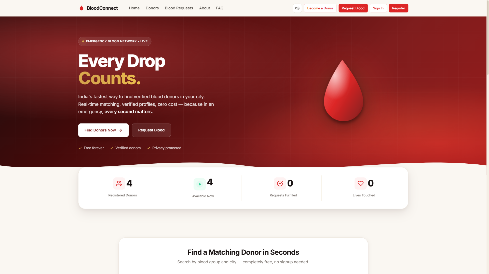
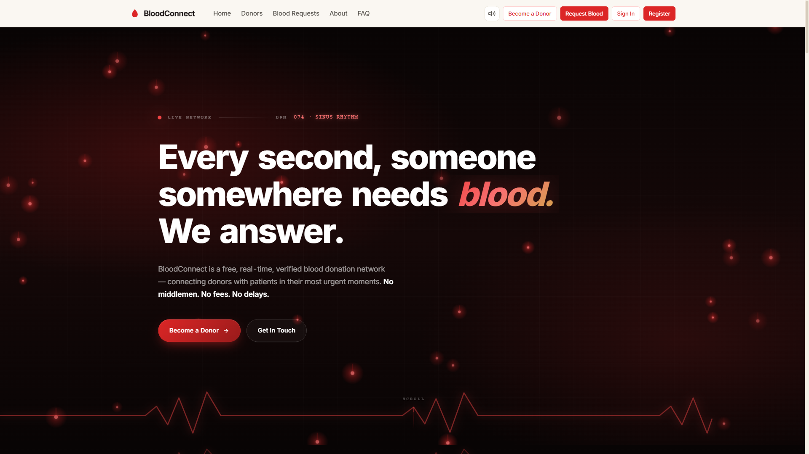
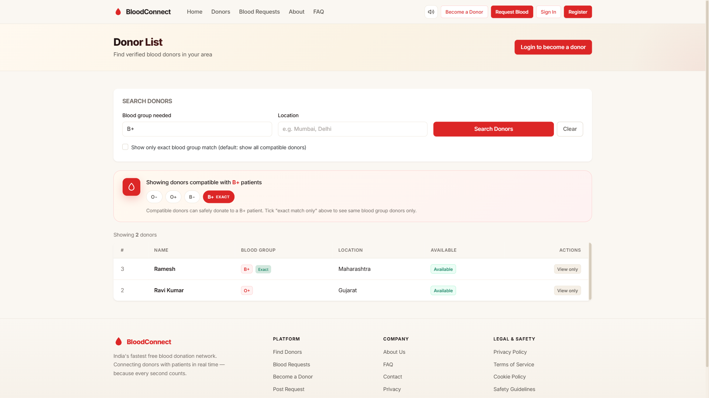
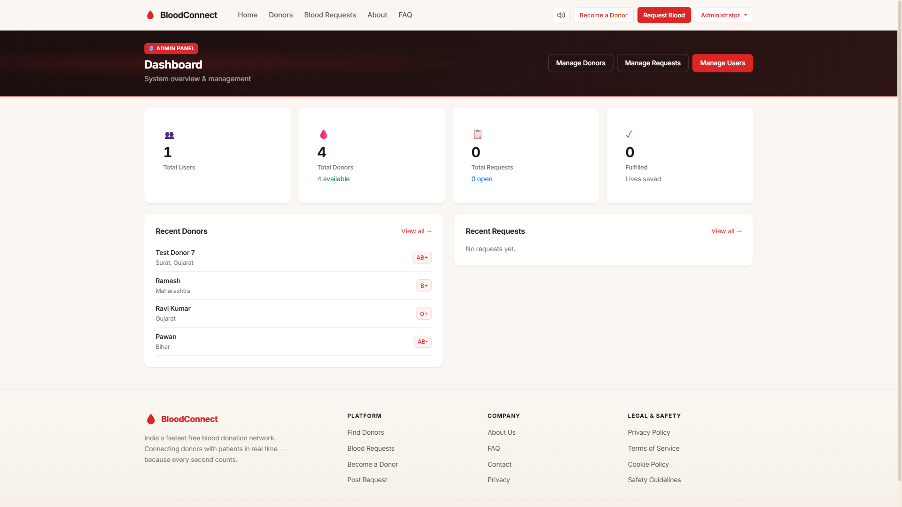
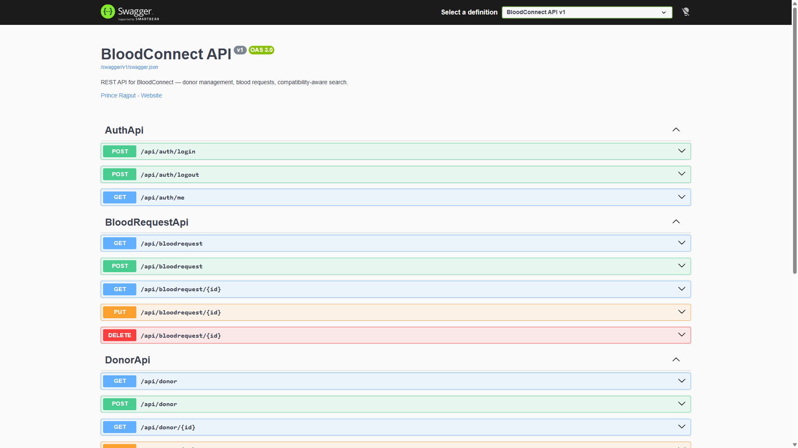
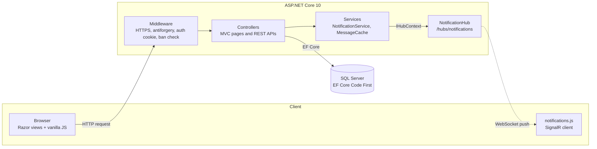
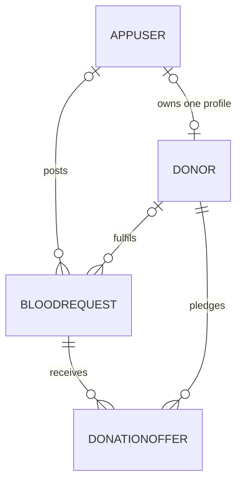
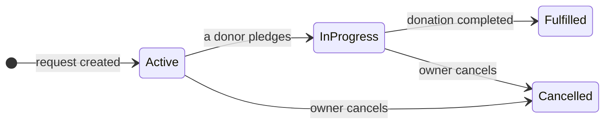
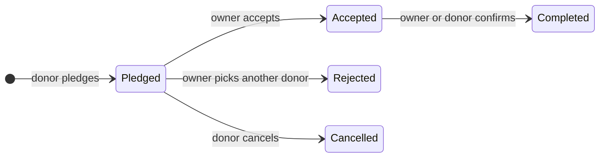
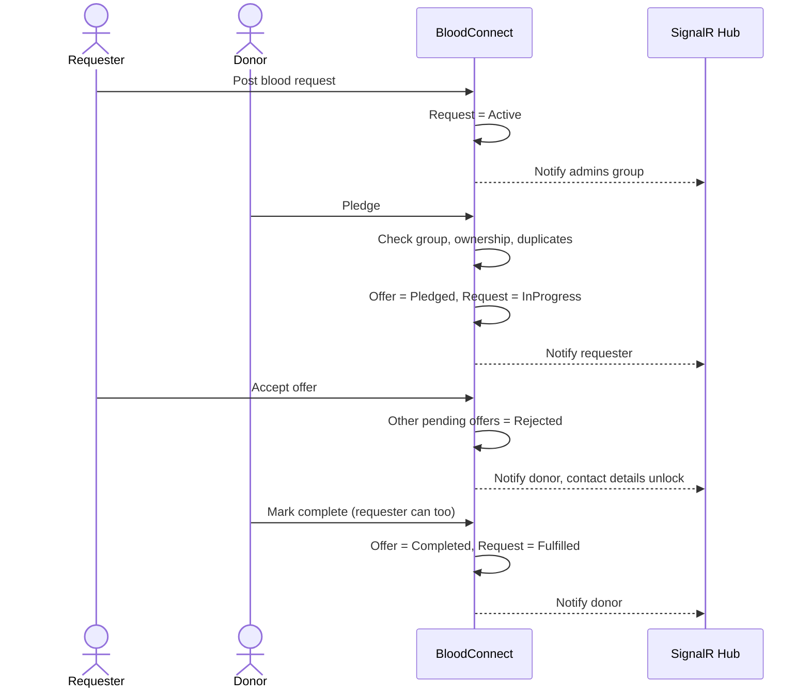

<div align="center">

# 🩸 BloodConnect

### Every Drop Counts. A real-time blood donation network.

A full-stack platform that connects verified blood donors with patients in urgent need, using compatibility-aware search, a two-way pledge workflow, and live push notifications.

[](https://dotnet.microsoft.com/)
[](https://learn.microsoft.com/aspnet/core)
[](https://learn.microsoft.com/ef/core)
[](https://www.microsoft.com/sql-server)
[](https://dotnet.microsoft.com/apps/aspnet/signalr)

**[Live Demo](https://bloodconnector.runasp.net)** · **[Swagger API Docs](https://bloodconnector.runasp.net/swagger)** · **[Source](https://github.com/rajputpri/BloodConnector)** · **[Report a Bug](https://github.com/rajputpri/BloodConnector/issues)**

</div>

---

## Table of Contents

1. [The Problem and the Solution](#1-the-problem-and-the-solution)
2. [Screenshots](#2-screenshots)
3. [Key Features](#3-key-features)
4. [Tech Stack](#4-tech-stack)
5. [Architecture](#5-architecture)
6. [Domain Model](#6-domain-model)
7. [Donation Workflow](#7-donation-workflow)
8. [Blood Compatibility Logic](#8-blood-compatibility-logic)
9. [Real-Time Notifications](#9-real-time-notifications)
10. [Security and Identity](#10-security-and-identity)
11. [Authorization Model](#11-authorization-model)
12. [API Documentation](#12-api-documentation)
13. [Quick Start](#13-quick-start)
14. [Configuration](#14-configuration)
15. [Project Structure](#15-project-structure)
16. [Testing and Verification](#16-testing-and-verification)
17. [Deployment](#17-deployment)
18. [Design Decisions](#18-design-decisions)
19. [Known Limitations](#19-known-limitations)
20. [Roadmap](#20-roadmap)
21. [Documentation Index](#21-documentation-index)
22. [Contributing, License, Author](#22-contributing-license-author)

---

## 1. The Problem and the Solution

### 😟 The problem

- 📱 **Scattered coordination.** Blood requests travel through WhatsApp groups, phone calls and social media, with no single place to see who needs what.
- ❓ **No verification.** Nobody knows if a donor is genuine, available, or will actually show up.
- 🧪 **Wrong-group matching wastes time.** People contact donors who cannot medically donate to the patient.
- 📞 **Privacy leaks.** Phone numbers get posted publicly and end up in spam lists.
- 🙈 **Zero visibility.** The requester cannot see whether anyone has responded.

### ✅ The solution

| Problem | BloodConnect answer | Design guarantee |
|---|---|---|
| Scattered coordination | One network with a live request board | One source of truth |
| Unverified donors | Pledge, then accept, then complete (two-way confirmation) | No fulfilment without both sides |
| Wrong-group matches | Built-in red-cell compatibility matrix | Search returns only compatible donors |
| Privacy leaks | Contact details hidden until an offer is accepted | 0 phone numbers shown before consent |
| Duplicate or fake pledges | Unique `(RequestId, DonorId)` index plus server-side rules | 0 duplicate pledges, enforced by the database |
| No visibility | SignalR push to the right person at every state change | 0 polling requests |

> The guarantees above come from the design and the database constraints, not from load testing. No performance benchmarks are claimed.

---

## 2. Screenshots

<table>
  <tr>
    <td width="50%"><h4>Homepage</h4></td>
    <td width="50%"><h4>Real-time notifications</h4></td>
  </tr>
  <tr>
    <td width="50%"><h4>Blood compatibility chart</h4></td>
    <td width="50%"><h4>Compatibility-aware search</h4></td>
  </tr>
  <tr>
    <td width="50%"><h4>Admin dashboard</h4></td>
    <td width="50%"><h4>Swagger API docs</h4></td>
  </tr>
</table>

---

## 3. Key Features

### 👤 For users
- Register and sign in with ASP.NET Core Identity (hashed passwords, lockout protection).
- Post blood requests with urgency level, location and contact details.
- Search compatible donors by blood group, state and availability.
- Track a request live: `Active → InProgress → Fulfilled`.
- Manage everything from a personal dashboard.

### 🩸 For donors
- Create a donor profile with age validation (18 to 65).
- Pledge on requests through the two-way confirmation flow.
- Browse only the requests your blood group can medically serve.
- Control availability at any time and get instant alerts when an offer is accepted.

### 🛡️ For admins
- Ban, unban, promote, demote and delete users, with a strict role hierarchy.
- Moderate donors and blood requests.
- Contact-message inbox with read/unread tracking and a cached badge count.
- Dashboard statistics and a live notification feed.

### ⚙️ Engineering highlights
- SignalR WebSocket push with no polling.
- REST API with Swagger/OpenAPI, using DTOs so contact data is never leaked.
- `RowVersion` optimistic concurrency on donor records.
- Global CSRF protection through `AutoValidateAntiforgeryToken`.
- Hybrid caching: `IMemoryCache` plus SignalR plus explicit invalidation on writes.
- Web Audio notification chime (two tones, 880 Hz and 1174 Hz) with a persisted mute toggle.
- Compatibility rules centralised in one `BloodCompatibility` helper.
- EF Core migrations, branded 404/500 pages, and reduced-motion support.

---

## 4. Tech Stack

| Layer | Technology | Purpose |
|---|---|---|
| Runtime | .NET 10 | Application runtime |
| Web framework | ASP.NET Core 10 MVC | Server-rendered pages and REST controllers |
| Real-time | ASP.NET Core SignalR | WebSocket notifications |
| Data access | Entity Framework Core 10 (Code First) | ORM and migrations |
| Database | SQL Server Express (local), SQL Server (live) | Persistent storage |
| Authentication | ASP.NET Core Identity, cookie authentication | Sessions, roles, lockout |
| API docs | Swashbuckle.AspNetCore (Swagger / OpenAPI 3) | Interactive API reference |
| Frontend | Razor views, Bootstrap 5, vanilla JavaScript | Responsive UI |
| Styling | Custom CSS, Inter font | Warm design system (cream, burgundy, gold) |
| Caching | `IMemoryCache` | 60-second unread-count cache |
| Sound | Web Audio API | Notification chime |
| Real-time client | `@microsoft/signalr` | Browser WebSocket client |
| API testing | Postman (cookie-based) | 28 recorded tests |

---

## 5. Architecture



**How a request travels:** the browser sends an HTTP request. Middleware validates the anti-forgery token and the auth cookie, then routes to a controller. The controller validates input, applies business rules, and talks to SQL Server through EF Core. After a successful save, `NotificationService` pushes the event through the SignalR hub to the right group.

### Design principles
- **Thin controllers:** orchestration only. Notification and cache logic live in services.
- **No database access in views:** controllers prepare everything a view needs.
- **DTOs for the API:** entities are never exposed directly.
- **Server-side validation always:** `[Required]`, `[Range]`, `[RegularExpression]` and a custom `[MustBeTrue]`.
- **Ownership checks in every mutating action**, in addition to role attributes.
- **Save first, then notify:** data is committed before any push is sent.

---

## 6. Domain Model



| Entity | Responsibility | Important fields |
|---|---|---|
| **AppUser** (extends `IdentityUser`) | Account and role | `FullName`, `IsBanned`, `CreatedAt` |
| **Donor** | A person who can donate | `DonorId`, `Name`, `BloodGroup`, `Location`, `ContactNumber`, `IsAvailable`, `Age`, `City`, `State`, `UserId`, `RowVersion` |
| **BloodRequest** | A patient's need | `RequestId`, `RequesterName`, `BloodGroupNeeded`, `UrgencyLevel`, `Status`, `Location`, `City`, `State`, `ContactNumber`, `RequestDate`, `FulfilledByDonorId`, `UserId` |
| **DonationOffer** | A donor's pledge on a request | `Id`, `RequestId`, `DonorId`, `Status`, `CreatedAt`, `AcceptedAt`, `CompletedAt` |
| **ContactMessage** | Message from the contact form | `Id`, `Name`, `Email`, `Subject`, `Message`, `CreatedAt`, `IsRead`, `ReadAt` |

**Constraints worth knowing**
- Unique index on `DonationOffer (RequestId, DonorId)` stops duplicate pledges at the database level.
- `Donor.RowVersion` provides optimistic concurrency.
- `BloodRequest.UserId` is nullable to allow requests without an account.
- `BloodRequest.UrgencyLevel` and `Status` are stored as strings, not enums.

> **Naming note:** the SQL column names differ from some C# property names (`RequesterName` is `PatientName` in the model, `BloodGroupNeeded` is `BloodGroup`, `RequestDate` is `CreatedAt`). Use the actual column names in raw SQL and in documentation.

---

## 7. Donation Workflow

A request and an offer have **separate** status values:

| Entity | Values |
|---|---|
| `BloodRequest.Status` | `Active`, `InProgress`, `Fulfilled`, `Cancelled` |
| `DonationOffer.Status` | `Pledged`, `Accepted`, `Rejected`, `Cancelled`, `Completed` |







### Business rules
- A donor can pledge **once per request** (unique index).
- A user **cannot pledge on their own request**.
- The donor's blood group must be **compatible** with the request (validated on the server).
- Accepting one offer **auto-rejects** every other pending offer.
- **Contact details unlock only after acceptance.**
- Both the requester **and** the accepted donor can mark the donation complete.
- A fulfilled request **cannot accept new offers**.
- Every state change triggers a real-time notification.

---

## 8. Blood Compatibility Logic

| Recipient | Can receive red cells from |
|---|---|
| **O−** | O− |
| **O+** | O−, O+ |
| **A−** | O−, A− |
| **A+** | O−, O+, A−, A+ |
| **B−** | O−, B− |
| **B+** | O−, O+, B−, B+ |
| **AB−** | O−, A−, B−, AB− |
| **AB+** | All 8 groups |

- **O−** is the universal red-cell donor. **AB+** is the universal red-cell receiver.
- The matrix lives in one place, `Models/BloodCompatibility.cs`, and is reused by the web search, the API search, and offer validation, so the three can never disagree.

---

## 9. Real-Time Notifications

| Trigger | Who is notified | Delivery |
|---|---|---|
| New blood request posted | All admins | Bell badge, toast, sound |
| New contact message | All admins | Bell badge, toast, sound |
| Donor pledges on a request | Request owner | Bell badge, toast, sound |
| Owner accepts or rejects an offer | The donor | Bell badge, toast, sound |
| Donation completed | The donor | Bell badge, toast, sound |

**How it works**
- A persistent **SignalR WebSocket** connects to `/hubs/notifications` on page load.
- **Groups** decide who hears what: `admins` for admin alerts, `user_{id}` for personal ones.
- Controllers never touch the hub directly. `NotificationService` pushes through `IHubContext`.
- The client receives `ReceiveNotification` and then: bounces the badge, rings the bell for 0.6 s, prepends the dropdown item, plays the chime, shows a toast (auto-dismiss after 7 s) and makes the toast clickable to the target URL.
- The client reconnects automatically with exponential backoff.
- For first page load, unread counts come from `IMemoryCache` (60-second TTL) and are **invalidated on every write**. Non-admin users trigger no count query.

**Payload**

```json
{
  "type": "request",
  "title": "New A+ request",
  "message": "Rahul Sharma · Mumbai, Maharashtra",
  "url": "/BloodRequest/Index",
  "timestamp": "2026-10-12T14:23:45.123Z"
}
```

**Server-side push (save first, then notify)**

```csharp
_context.BloodRequests.Add(request);
await _context.SaveChangesAsync();
await _notifications.PushNewRequestToAdminsAsync(request);
```

---

## 10. Security and Identity

| Defence | Threat | How it is implemented |
|---|---|---|
| **Cookie authentication** | Session theft | Cookie `.AspNetCore.Identity.Application` with `HttpOnly = true` and `SameSite = Lax`. Sliding expiration of 7 days. No tokens in JavaScript-accessible storage. |
| **Anti-forgery tokens** | CSRF | `AutoValidateAntiforgeryToken` applied globally to every state-changing request. |
| **Ownership checks** | IDOR | Controllers compare the record's owner with the signed-in user. A mismatch returns `403 Forbidden`. Admins are the only exception. |
| **Razor output encoding** | XSS | A stored `<script>` payload renders as plain text. |
| **EF Core parameterised queries** | SQL injection | Search input is always a parameter, never concatenated SQL. |
| **Identity password hashing and lockout** | Credential attacks | Passwords are hashed. Five failed attempts lock the account. Weak passwords are rejected. |
| **Ban enforcement** | Abusive accounts | The cookie's `OnValidatePrincipal` event checks `IsBanned` on every request and signs the user out immediately. |
| **Role hierarchy** | Privilege abuse | SuperAdmin (immutable) over Admin over User, enforced on the server. |
| **Unique index and `RowVersion`** | Duplicate pledges and lost updates | Database-level uniqueness plus optimistic concurrency. |
| **DTOs and consent-based contact reveal** | Data leakage | API responses use DTOs. Phone numbers appear only after an offer is accepted. |
| **HTTPS** | Eavesdropping | Let's Encrypt certificate on the live site. |

Security testing performed: XSS, SQL-injection and IDOR attempts were run against the app, and the API's `400`, `401`, `403`, `404` and `409` responses were exercised through Postman. See [docs/SECURITY.md](docs/SECURITY.md) for the full analysis.

---

## 11. Authorization Model

```text
SuperAdmin   (immutable, cannot be banned or deleted)
   └── Admin     (manages users below, moderates content)
          └── User   (basic access, owns own data)
```

| Action | User | Admin | SuperAdmin |
|---|:---:|:---:|:---:|
| Edit own donor profile | ✅ | ✅ | ✅ |
| Edit another user's profile | ❌ | ❌ | ❌ |
| Delete own request | ✅ | ✅ | ✅ |
| Delete another user's request | ❌ | ✅ | ✅ |
| Ban a regular user | ❌ | ✅ | ✅ |
| Ban an Admin | ❌ | ❌ | ✅ |
| Ban a SuperAdmin | ❌ | ❌ | ❌ |
| Promote User → Admin | ❌ | ✅ | ✅ |
| Demote Admin → User | ❌ | ❌ | ✅ |
| Delete a SuperAdmin | ❌ | ❌ | ❌ |
| Ban or delete yourself | ❌ | ❌ | ❌ |

---

## 12. API Documentation

**Interactive docs:** [bloodconnector.runasp.net/swagger](https://bloodconnector.runasp.net/swagger) · **Postman collection:** [`docs/postman/`](docs/postman/) · **Reference:** [docs/API.md](docs/API.md)

> 🔐 **Authentication.** Protected endpoints use **cookie authentication** (`.AspNetCore.Identity.Application`), not JWT. Call `POST /api/auth/login` first. The response sets the cookie, and Postman or Swagger sends it automatically on later calls.

| Method | Endpoint | Auth | Purpose |
|---|---|:---:|---|
| `POST` | `/api/auth/login` | Public | Sign in with JSON, returns the auth cookie |
| `POST` | `/api/auth/logout` | 🔒 | End the session |
| `GET` | `/api/auth/me` | 🔒 | Current user and roles |
| `GET` | `/api/donor` | Public | List donors (paginated) |
| `GET` | `/api/donor/{id}` | Public | Get one donor |
| `GET` | `/api/donor/search` | Public | Compatibility-aware search |
| `POST` | `/api/donor` | 🔒 | Create a donor profile |
| `PUT` | `/api/donor/{id}` | 🔒 Owner/Admin | Update a donor |
| `DELETE` | `/api/donor/{id}` | 🔒 Owner/Admin | Delete a donor |
| `GET` | `/api/bloodrequest` | Public | List blood requests |
| `GET` | `/api/bloodrequest/{id}` | Public | Get one request |
| `POST` | `/api/bloodrequest` | 🔒 | Create a request |
| `PUT` | `/api/bloodrequest/{id}` | 🔒 Owner/Admin | Update a request |
| `DELETE` | `/api/bloodrequest/{id}` | 🔒 Owner/Admin | Delete a request |

**Status codes returned:** `200`, `201`, `400` (validation), `401` (not signed in), `403` (not the owner), `404` (not found), `409` (duplicate donor profile).

**Sign in**

```http
POST /api/auth/login
Content-Type: application/json

{ "email": "you@example.com", "password": "<your-password>" }
```

Response: `200 OK` with `Set-Cookie: .AspNetCore.Identity.Application=...`

**Search compatible donors:** `GET /api/donor/search?bloodGroup=B%2B`

```json
{
  "total": 2,
  "page": 1,
  "pageSize": 20,
  "searchMode": "compatible",
  "requestedBloodGroup": "B+",
  "compatibleGroups": ["O-", "O+", "B-", "B+"],
  "results": [
    { "donorId": 15, "name": "Gaurav", "bloodGroup": "B+", "state": "Bihar", "location": "Bihar", "isExactMatch": true }
  ]
}
```

---

## 13. Quick Start

### Prerequisites

| Requirement | Notes |
|---|---|
| [.NET 10 SDK](https://dotnet.microsoft.com/download) | Check with `dotnet --version` |
| **SQL Server Express** *or* **SQL Server LocalDB** | One of the two is required. Install **before** running migrations. LocalDB ships with Visual Studio. |
| [Git](https://git-scm.com/) | To clone the repository |
| `dotnet-ef` tool | `dotnet tool install --global dotnet-ef` |
| Optional | VS Code with C# Dev Kit, or Visual Studio 2022+ |

### Install and run

```bash
# 1. Clone
git clone https://github.com/rajputpri/BloodConnector.git
cd BloodConnector

# 2. Restore packages
dotnet restore

# 3. Install the EF Core CLI (skip if already installed)
dotnet tool install --global dotnet-ef

# 4. Set your connection string (see "Configuration" below)

# 5. Create the database from the migrations
dotnet ef database update

# 6. Run
dotnet run
```

The app starts at **http://localhost:5006**.

On first run the seeder creates the roles and a development admin account (`admin@bloodconnect.com`). The seeded password is defined in `Models/DbSeeder.cs`. **Change it before any deployment.**

### Troubleshooting

| Symptom | Fix |
|---|---|
| `dotnet ef` is not recognised | Run `dotnet tool install --global dotnet-ef`, then reopen the terminal. |
| `A network-related or instance-specific error` | The SQL Server instance name in your connection string is wrong or the service is stopped. Check the instance name in SSMS. |
| Login to SQL fails | Keep `Trusted_Connection=True` for Windows auth on local machines. |
| Port 5006 is already in use | Change the port in `Properties/launchSettings.json`. |
| CSS or JS changes do not appear | Hard refresh with `Ctrl + F5`. |

---

## 14. Configuration

**Development: `appsettings.Development.json`**

SQL Server Express (the instance name may differ on your machine):

```json
{
  "ConnectionStrings": {
    "DefaultConnection": "Server=.\\SQLEXPRESS;Database=BloodConnectDb;Trusted_Connection=True;TrustServerCertificate=True;MultipleActiveResultSets=true"
  }
}
```

SQL Server LocalDB:

```json
{
  "ConnectionStrings": {
    "DefaultConnection": "Server=(localdb)\\MSSQLLocalDB;Database=BloodConnectDb;Trusted_Connection=True;TrustServerCertificate=True;MultipleActiveResultSets=true"
  }
}
```

**Production: `appsettings.Production.json`** (excluded from version control)

```json
{
  "ConnectionStrings": {
    "DefaultConnection": "Server=YOUR_SERVER;Database=YOUR_DB;User Id=YOUR_USER;Password=YOUR_PASSWORD;TrustServerCertificate=True;MultipleActiveResultSets=True"
  }
}
```

| Environment variable | Purpose |
|---|---|
| `ASPNETCORE_ENVIRONMENT` | Set to `Production` on the host |
| `ConnectionStrings__DefaultConnection` | Overrides the connection string without a file |

> Never commit real credentials. Prefer environment variables or your host's secret store.

---

## 15. Project Structure

```text
BloodConnect/
├── Controllers/
│   ├── HomeController.cs              # Home, About, FAQ, Contact, Privacy, Error
│   ├── DonorController.cs             # Donor CRUD and compatibility search
│   ├── BloodRequestController.cs      # Request CRUD and the offer workflow
│   ├── AccountController.cs           # Register, login, logout (MVC)
│   ├── AdminController.cs             # Admin panel and role management
│   ├── DashboardController.cs         # User dashboard
│   ├── DonorApiController.cs          # REST: donors
│   ├── BloodRequestApiController.cs   # REST: requests
│   └── AuthApiController.cs           # REST: login, logout, me
├── Hubs/
│   └── NotificationHub.cs             # SignalR hub
├── Models/
│   ├── AppUser.cs  Donor.cs  BloodRequest.cs  DonationOffer.cs  ContactMessage.cs
│   ├── BloodCompatibility.cs          # Compatibility matrix
│   ├── DomainValues.cs                # Blood groups, states, status constants
│   ├── ValidationAttributes.cs        # Custom validators (MustBeTrue)
│   ├── ApplicationDbContext.cs  DbSeeder.cs
│   ├── ApiDtos.cs  ViewModels.cs
├── Services/
│   ├── MessageCache.cs                # Cached unread count
│   └── NotificationService.cs         # SignalR push and cache invalidation
├── Migrations/                        # EF Core migrations
├── Views/                             # Razor views (Shared, Home, Donor, BloodRequest, Account, Admin, Dashboard)
├── wwwroot/
│   ├── css/  site.css  animations.css  notifications.css
│   ├── js/   site.js   animations.js   notifications.js
│   └── lib/                           # Bootstrap, jQuery
├── docs/                              # API, architecture, deployment, security, manual, changelog, postman, screenshots
├── Program.cs
└── appsettings*.json
```

---

## 16. Testing and Verification

Testing is currently **manual plus Postman**. Automated unit and integration tests are on the roadmap.

| Area | Scenarios covered |
|---|---|
| Authentication | Register, login, logout, lockout after 5 attempts, weak-password rejection |
| Authorization | Owner-only edit, admin delete, role hierarchy, self-protection |
| Ban system | Banned user signed out on the next request, login denied |
| Donor CRUD | Create, edit, delete, age validation (18 to 65), duplicate profile (`409`) |
| Search | Compatible and exact matches, ordering, state filter |
| Workflow | Pledge, accept, reject competing offers, cancel, complete |
| Compatibility | All 8 groups including the universal donor and receiver cases |
| Contact inbox | Persistence, read/unread, deletion, cache invalidation |
| Real-time | Bell badge, toast, sound, live dropdown updates |
| Security | XSS payload stored as text, SQL-injection input in search, IDOR delete returns `403` |
| Errors | Branded 404 and 500 pages without stack traces |

**API:** 28 Postman tests are recorded. Screenshots are in [`docs/screenshots/api-deployment/`](docs/screenshots/api-deployment/) and the collection is in [`docs/postman/`](docs/postman/).

**Real-time test (two browsers):** sign in as admin in browser A, sign in as a normal user in browser B and post a request. Browser A should show the toast, sound and badge immediately.

---

## 17. Deployment

**Live:** [bloodconnector.runasp.net](https://bloodconnector.runasp.net)

| Component | Service |
|---|---|
| Hosting | MonsterASP.NET (free tier) |
| Database | SQL Server (managed by the host) |
| HTTPS | Let's Encrypt |
| Real-time | SignalR over WebSocket |

Full steps: [docs/DEPLOYMENT.md](docs/DEPLOYMENT.md).

---

## 18. Design Decisions

| Decision | Why |
|---|---|
| **Cookie authentication, not JWT** | The UI is server-rendered, so the browser sends the cookie automatically. `HttpOnly` keeps it out of JavaScript, and the server can invalidate a session instantly (for example when a user is banned). The REST API reuses the same cookie. |
| **SignalR instead of polling** | One persistent connection pushes events as they happen. Polling would add constant requests for no benefit. |
| **Pledge, accept, complete (two-way)** | Prevents fake fulfilment and gives both sides control. |
| **Contact details hidden until acceptance** | Protects donors' privacy and reduces spam. |
| **Unique index on `(RequestId, DonorId)`** | The database is the last line of defence even if application logic has a bug. |
| **`RowVersion` on donors** | Detects two simultaneous edits instead of silently overwriting. |
| **Notifications through a service** | Keeps controllers thin and the push logic reusable. |
| **Save first, then notify** | A notification is never sent for data that failed to save. |
| **Compatibility in one helper** | One source of truth for search, API and validation. |

---

## 19. Known Limitations

Being upfront about what is not covered:

- ⚠️ **Single-server caching.** `IMemoryCache` lives in one process. Running multiple instances would need a distributed cache, and SignalR would need a backplane (for example Redis).
- ⚠️ **No automated test suite yet.** Verification is manual and Postman-based.
- ⚠️ **No email or SMS delivery.** Notifications are in-app only. Two-factor authentication is not implemented.
- ⚠️ **Simplified medical logic.** Compatibility covers red cells only. There is no eligibility check (weight, last donation date).
- ⚠️ **Free-tier hosting.** The first request after idle time can be slow.

---

## 20. Roadmap

**Completed**
- [x] Identity auth, roles, ban system, role hierarchy
- [x] Donor and blood-request CRUD with validation
- [x] Compatibility-aware search (web and API)
- [x] Pledge-based donation workflow
- [x] Contact inbox with cached unread badge
- [x] REST API with Swagger and cookie-based auth endpoints
- [x] Live deployment with HTTPS
- [x] SignalR notifications: bell, toast, sound

**Planned**
- [ ] Automated unit and integration tests
- [ ] Email notifications (SendGrid) and SMS alerts (Twilio)
- [ ] Donation eligibility check (weight, last donation date, cooldown)
- [ ] Analytics dashboard (Chart.js)
- [ ] Map-based donor and request view
- [ ] Multi-language support (Hindi, Gujarati)
- [ ] Two-factor authentication
- [ ] Hospital integration API

---

## 21. Documentation Index

| Document | Purpose |
|---|---|
| [docs/API.md](docs/API.md) | Complete API reference |
| [docs/ARCHITECTURE.md](docs/ARCHITECTURE.md) | System design and data model |
| [docs/DEPLOYMENT.md](docs/DEPLOYMENT.md) | Step-by-step deployment |
| [docs/SECURITY.md](docs/SECURITY.md) | Security model and threat analysis |
| [docs/USER_MANUAL.md](docs/USER_MANUAL.md) | End-user guide |
| [docs/CHANGELOG.md](docs/CHANGELOG.md) | Version history |
| [docs/postman/](docs/postman/) | Postman collection |

---

## 22. Contributing, License, Author

**Contributing.** This is an educational project. Bug fixes, documentation improvements and UI suggestions are welcome: fork, create a feature branch, commit, push and open a pull request.

**License.** Shared for educational and review purposes. Unless a `LICENSE` file in this repository states otherwise, all rights are reserved by the author.
<!-- TODO: add a LICENSE file (for example MIT) if you want others to reuse the code. -->

**Author.** **Prince Rajput**, BCA (Honours) Semester 7, Lokmanya College of Computer Applications, Gujarat University. Course: Full Stack Web Development Project using ASP.NET Core (DSC-M-BCA-471P).
<!-- TODO: confirm the course code against the official syllabus. -->

[](https://github.com/rajputpri)

> ⚠️ **Disclaimer.** BloodConnect is an educational project. It is not a medical, emergency-response or blood-bank system. The compatibility lookup is a simplified reference and does not replace professional blood typing, crossmatching, screening or clinical judgement. Do not rely on it for real medical decisions.

<div align="center">

**Made in India · Every drop counts.** 🩸

</div>